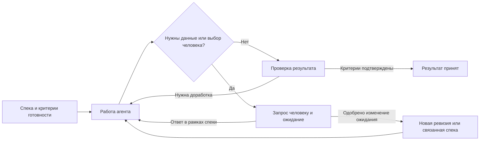

# Ouro: методология дорожных карт и графов

Статус: исследовательская записка и проектные рекомендации, не утверждённый стандарт Ouro. Дата изучения локально загруженных первоисточников: 2026-10-28. Код и макеты не изменялись.

## 1. Что подтверждают источники

| Источник | Подтверждённое положение | Применение к Ouro — предлагаемое решение |
|---|---|---|
| Mermaid Flowcharts [1] | Блок-схема состоит из узлов и направленных/ненаправленных связей; поддерживает подписи, формы, подграфы и раскладку. | Использовать явную семантику узлов и связей; структуру и внешний вид хранить отдельно. |
| Mermaid State Diagrams [2] | Диаграммы состояний описывают допустимые состояния и переходы; есть вложенные состояния, выбор и параллельные fork/join. | Статусные модели описывать таблицами переходов и state diagrams, а алгоритм работы — отдельной блок-схемой. |
| Microsoft Event Sourcing [3] | История хранится append-only, текущее состояние получают проигрыванием событий и проекциями; нужны порядок, конкуренция, идемпотентность и эволюция схем. Источник отдельно предупреждает о цене сложности. | Неизменяемая история решений оправдана назначением Ouro; граф и Human View строить как восстанавливаемые проекции. |
| CloudEvents 1.0.2 [4] | Событие отделяет данные факта от контекста; обязательны `id`, `source`, `specversion`, `type`; одинаковые `source` + `id` могут обозначать повторную доставку. В JSON для этой версии стандарта `specversion` равно `1.0`. | Для интеграции Meridian предусмотреть стандартную оболочку интеграционных событий; не подменять ею внутреннюю доменную модель и не записывать в `specversion` версию Ouro. |
| SemVer [5] | Версионирование требует явно объявленного публичного API; несовместимость, совместимое расширение и исправление имеют разные правила повышения версии. | Версионировать публичные контракты Ouro отдельно от ревизий пользовательских спек и визуальных координат графа. |
| GitHub Projects layouts [6] | Один проект может иметь разные представления: table, board, timeline-style roadmap; раскладка задаётся для каждого view. | Предусмотреть несколько представлений одних данных: граф зависимостей, список/таблица и очередь человеческих решений. Временную дорожную карту добавлять при наличии сроков. |
| Dagre [7], elkjs [8] | Dagre выполняет раскладку направленных графов на клиенте; elkjs отдельно вычисляет расположение и поддерживает направленные схемы с портами. | Выбирать движок раскладки отдельно от React Flow и предметной модели; сравнить на репрезентативных схемах. |
| W3C Understanding Pause, Stop, Hide [9] | Движение и автоматические изменения могут мешать чтению; рассматриваются механизмы остановки/скрытия и управления обновлениями, различаются статичная и актуальная realtime-информация. | Дать человеку контроль над анимацией и визуальными обновлениями, сохранив приём событий; при возвращении к live явно показать актуальность. |
| ADR, шаблон adr-tools [10] | Шаблон решения содержит номер/название, дату, статус, контекст, решение и последствия. | Представлять принятое решение в человекочитаемой карточке, связанной с исходным запросом и последствиями. |

Единого универсального «лучшего стандарта» для всех трёх представлений источники не устанавливают. Следующая методология — синтез для задач Ouro. Использование Mermaid для документации не означает обязательного использования Mermaid в интерактивном UI: в исходной ТС для UI выбран React Flow.

## 2. Три разных представления

| Представление | Вопрос человека | Узлы и связи | Циклы |
|---|---|---|---|
| Roadmap / зависимости | Что нужно получить и что чему предшествует? | Спеки; `depends_on` и отдельно классифицированные связи | Подграф обязательных зависимостей — DAG; циклы запрещены. |
| Flow / логика выполнения | Какой путь возможен и где требуется выбор? | Действие, условие/выбор, ожидание, результат; подписанные переходы | Повторная попытка или уточнение могут образовывать логический цикл. |
| Reality / история фактов | Что произошло, почему и какое решение принято? | Конкретные события и причинные ссылки; хронологический список как базовый режим | Каждая повторная попытка — новое событие. Причинные ссылки не должны создавать обратную причинность. |

Важное различие: цикл в шаблоне процесса «проверить → исправить → проверить» допустим. В истории исполнения это разные проверки и разные исправления, а не перезапись одного узла. Поэтому развёрнутый причинный граф конкретных фактов может оставаться ацикличным, хотя блок-схема процесса содержит цикл.

Смена статуса не должна добавлять новый тип зависимости. Связи `relates_to`, `derived_from`, `replaces` не следует автоматически трактовать как `depends_on` и использовать для блокирования запуска.

## 3. Правила дорожной карты

1. Зафиксировать одно направление: **предпосылка → зависимая спека**. В UI подпись поясняет «нужно до начала»; в данных хранится однозначный тип и имена концов связи.
2. Проверять достижимость при добавлении зависимости: связь, замыкающая цикл `depends_on`, отклоняется с объяснением найденной цепочки. Проверка относится к конкретному проекту и согласованной версии графа.
3. Группировать по результату/этапу/области, а не требовать, чтобы все задачи всегда были одновременно видимы. Верхний уровень показывает результат и исключения; раскрытие — составляющие спеки.
4. На узле показывать Human ID, короткое название, состояние исполнения и отдельный индикатор ожидаемого человеческого решения. Длинные причины, варианты и аудит — в детальном просмотре.
5. Статус и доступность следующей задачи выводить из доменной модели. Положение узла, направление отрисовки или цвет не определяют бизнес-правила.
6. Не обозначать предварительную оценку как обязательство по сроку. Для дорожной карты без оценок сначала достаточно зависимостей, приоритетов и этапов.
7. Сохранять семантические изменения графа событиями: кто и почему добавил/снял зависимость. Локальный zoom, фильтры и пользовательские координаты хранить отдельно; перестановка карточки не меняет ожидания и не должна увеличивать метрику дрейфа.

Практика GitHub Projects [6] подтверждает полезность разных views одних данных, но не устанавливает DAG как универсальную модель дорожной карты. Требование ацикличности выше относится именно к обязательным зависимостям Ouro и является предлагаемым доменным правилом.

## 4. Правила блок-схем и решений

- Действие изображать процессным узлом; условие или выбор пути — ромбом; ожидание решения человека — явным состоянием с адресатом. Геометрическая форма дополняет подпись.
- Подписывать исходящие пути смыслом: «выбран вариант A», «тест пройден», «нужны данные». Метки «да/нет» допустимы только рядом с однозначно сформулированным условием.
- Развилка Ouro, где человек выбирает одну альтернативу, соответствует **choice**, а не параллельному **fork/join** из state diagrams. Чтобы не путать терминологию, публичный тип `fork` можно оставить доменным именем, но в документации пояснить «выбор альтернативы».
- Показывать предложенные альтернативы отдельно от уже исполненного пути. Одобрение варианта не означает успешного исполнения: это разные события и разные статусы.
- Новая версия спеки или отдельная дочерняя спека появляется как явно одобренное следствие решения, а не просто потому, что узел имеет форму ромба.
- Для возврата после уточнения показывать целевую точку и условия возобновления. Независимые ветви могут продолжаться только при отсутствии блокирующей зависимости и в пределах разрешённого исполнения.
- Выделять границы «человек / агент / система» группами или дорожками, если это помогает читать ответственность; не смешивать принадлежность узла со статусным цветом.
- Для существенных решений сохранять краткую ADR-карточку [10]: контекст → принятое решение → последствия, со ссылками на исходный вопрос/развилку и человека, принявшего решение. Это человекочитаемое представление над теми же фактами, а не второй независимый журнал, который может разойтись с Reality.

Пример семантики, а не окончательный дизайн:

## 5. Читаемость Human View

Рекомендации для Ouro; это не утверждение о просмотренном макете Meridian:

- По умолчанию показывать человеческие исключения: нерешённые вопросы, развилки и блокеры. Полная история всегда доступна рядом.
- Использовать последовательное раскрытие L1 → L2 → L3, фильтры по типу/агенту/времени и фокус на соседях выбранного узла. Скрытые элементы обозначать счётчиком, чтобы фильтр не создавал впечатление отсутствия истории.
- Избегать схемы, где все возможные связи видны сразу. Объединять группы, сокращать подписи и предлагать подробности по выбору; число пересечений и устойчивость расположения важнее декоративной плотности.
- Передавать состояние текстом и иконкой в дополнение к цвету. Легенда видна; состояния различимы в монохромном режиме.
- Анимация необязательна для понимания и навигации: режим уменьшенного движения и статический признак интерактивности должны сохранять смысл интерфейса. Постоянная пульсация всех активных задач быстро конкурирует с сигналами, требующими ответа человека. W3C [9] обосновывает управление движением и автоматическими обновлениями; соответствие всей WCAG этой запиской не проверялось.
- При realtime-обновлении сохранять фокус, выделение и масштаб. Новое событие может обновить счётчик/индикатор; камера не должна произвольно перемещаться.
- Пауза Human View останавливает визуальное применение изменений, а не запись событий на сервере. Показывать «просмотр приостановлен», количество новых событий и команду «к актуальному состоянию»; после возврата не выдавать старый снимок за live. Это предлагаемая реализация с учётом различия realtime/статичной информации в [9].
- Для событий показывать как время факта, так и при необходимости время получения. Надёжный порядок внутри потока задавать серверной последовательностью, а не только клиентскими часами.
- Доступен эквивалент графа в виде списка/таблицы: поиск Human ID, переходы по зависимостям и очередь решений должны работать без точного наведения на линию.

## 6. Раскладка

Dagre [7] документирован как клиентская библиотека раскладки направленных графов. elkjs [8] описывает layered-алгоритм для направленных схем и явных портов; он вычисляет геометрию, не предоставляет полноценный редактор или rendering. Mermaid [1] также документирует оба подхода. Изученный файл Mermaid взят из движущейся ветки `develop`, поэтому его заявления о версиях и настройках по умолчанию не являются проверкой установленного релиза.

Предложение для React Flow:

- Начать с Dagre для простого иерархического графа зависимостей, если хватает предсказуемых направлений и базовой раскладки.
- Рассматривать ELK при портах, группах и требованиях к маршрутизации. Поддержка направленных схем с портами подтверждается README elkjs [8]; качество, нужные параметры вложенности и интеграция с конкретной версией React Flow на реальных данных здесь не проверялись.
- Дорогую раскладку выполнять вне основного потока UI; elkjs документирует поддержку Web Workers [8]. Установки или измерения производительности в этой задаче не проводились.
- Выбирать алгоритм по небольшому репрезентативному набору схем: длинная цепочка, широкая параллельность, несколько групп и множество перекрёстных связей. Решение не должно приниматься по одному красивому примеру.
- Зафиксировать координаты уже читаемой схемы и выполнять перераскладку управляемо. Результат автолэйаута — представление, а не новая версия предметного графа.

## 7. Критерии проверки методологии при реализации

1. Человек различает «агент работает», «агент ждёт моего ответа» и «работа завершена», даже если анимация отключена.
2. По любой принятой развилке можно открыть исходный запрос, альтернативы, ответившего человека и последующие действия.
3. Циклическая обязательная зависимость отклоняется, а повторная попытка исполнения сохраняется отдельным фактом.
4. Повторная доставка одного события не создаёт второй узел и не меняет метрику дважды.
5. Состояние на выбранный момент/номер события восстанавливается без изменения исходной истории; исправление показано новым событием.
6. Фильтрация и сворачивание групп не скрывают наличие нерешённых человеческих запросов без явного индикатора.
7. Смена раскладки не меняет статусы, идентичность спек, семантические зависимости и дрейф ожиданий.

Эти критерии пока не выполненные тесты: приложение отсутствует. Это предлагаемые сценарии приёмки.

## 8. Первоисточники и границы исследования

Прочитаны локальные копии, полученные родительским агентом через разрешённые HTTPS-адреса; ниже указаны канонические страницы и точные адреса загруженных файлов. Это исследование документации, а не проведённое сравнение всех инструментов или исследование пользователей.

1. **Mermaid Flowcharts:** https://mermaid.js.org/syntax/flowchart.html — загруженная копия: https://raw.githubusercontent.com/mermaid-js/mermaid/develop/packages/mermaid/src/docs/syntax/flowchart.md
2. **Mermaid State Diagrams:** https://mermaid.js.org/syntax/stateDiagram.html — загруженная копия: https://raw.githubusercontent.com/mermaid-js/mermaid/develop/packages/mermaid/src/docs/syntax/stateDiagram.md
3. **Microsoft Azure Architecture Center, Event Sourcing pattern:** https://learn.microsoft.com/en-us/azure/architecture/patterns/event-sourcing — загруженная копия: https://raw.githubusercontent.com/microsoftdocs/architecture-center/main/docs/patterns/event-sourcing.md
4. **CloudEvents specification 1.0.2:** https://github.com/cloudevents/spec/blob/v1.0.2/cloudevents/spec.md — загруженная копия: https://raw.githubusercontent.com/cloudevents/spec/v1.0.2/cloudevents/spec.md
5. **Semantic Versioning:** https://semver.org/ — загруженная копия: https://raw.githubusercontent.com/semver/semver/master/semver.md
6. **GitHub Docs, Changing the layout of a view:** https://docs.github.com/en/issues/planning-and-tracking-with-projects/customizing-views-in-your-project/changing-the-layout-of-a-view — загруженная копия: https://raw.githubusercontent.com/github/docs/main/content/issues/planning-and-tracking-with-projects/customizing-views-in-your-project/changing-the-layout-of-a-view.md
7. **Dagre README:** https://github.com/dagrejs/dagre — загруженная копия: https://raw.githubusercontent.com/dagrejs/dagre/master/README.md
8. **elkjs README:** https://github.com/kieler/elkjs — загруженная копия: https://raw.githubusercontent.com/kieler/elkjs/master/README.md
9. **W3C, Understanding SC 2.2.2 Pause, Stop, Hide:** https://www.w3.org/WAI/WCAG22/Understanding/pause-stop-hide.html — загруженная копия: https://raw.githubusercontent.com/w3c/wcag/main/understanding/20/pause-stop-hide.html
10. **adr-tools, ADR template:** https://github.com/npryce/adr-tools/blob/master/src/template.md — загруженная копия: https://raw.githubusercontent.com/npryce/adr-tools/master/src/template.md

Канонические страницы отдельно не открывались в рамках этой подзадачи. CloudEvents использован из стабильного тега `v1.0.2`; первоначально загруженный `cloudevents.md` из `main` не является опорным источником. Остальные исходники из `main`/`master`/`develop` не закреплены коммитом; при фиксации библиотек потребуется проверить документацию выбранных версий. Стандарты BPMN/UML целиком не изучались, соответствие им не заявляется. Figma Meridian не просмотрена, её токены и компоненты не выдумываются.
