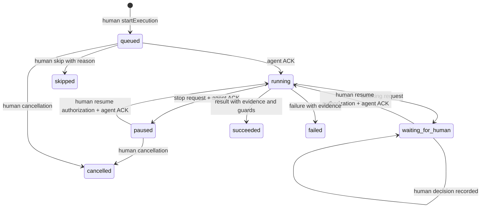
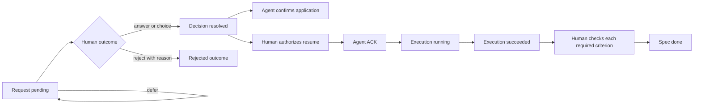

# Исполняемые статусные модели прототипа

В alpha.3 эти четыре оси доступны интерактивно: **Спецификации → Состояния**, граф/список, текущее подтверждённое состояние, правила и реальные переходы. Процессная схема — отдельная вкладка **Процесс**, она не подменяет автомат. [Инструкция](flow-guide.md), [проверки](plans/flow-visualization.md).

Источник поведения: [engine.ts](../packages/core/src/engine.ts), [типы](../packages/core/src/types.ts), [тесты](../tests/core.test.ts). Полная целевая модель: [status-methodology.md](status-methodology.md). Принцип независимых автоматов и guards сверялся с [W3C SCXML](https://www.w3.org/TR/scxml/); SCXML-файл/движок не реализован.

| Ось | Состояния | Авторитетный переход |
|---|---|---|
| Roadmap | draft, active, frozen, archived | Человек; freeze запрашивает остановку, не подделывает ACK |
| Spec | idea, specified, in_progress, blocked, done, invalidated | Projection текущей ревизии; `done` только после human acceptance |
| Execution | queued, running, waiting_for_human, paused, succeeded, failed, cancelled, skipped | Разрешение человека и отдельные факты/ACK исполнителя |
| DecisionRequest | pending, resolved, superseded, withdrawn | Human outcome; author withdrawal; activation новой ревизии явно supersede старые pending |
| Application | Не применено / подтверждено | Отдельное событие DecisionApplied |
| Acceptance | Не принято / принято с evidence каждого обязательного критерия | Отдельное SpecAccepted от человека |

Схема сокращает двухшаговые переходы в подписи. `resumeAuthorized` и `stopRequested` — отдельные признаки, отображаемые UI до ACK. Command receipt означает сохранение факта, а не успех выполнения. Поздний Action старой ревизии остаётся фактом старого контекста и не возобновляет работу.

Fork Ouro — исключающий человеческий выбор, не параллельный gateway BPMN. Blocker approval разрешает план, но сохраняет препятствие: отдельная remediation должна успешно завершиться и предъявить evidence. Другие блокировки при remediation остаются в силе. Ответ/отклонение, запуск и DoD не сливаются в один статус.

Новая активная ревизия не переписывает события: stopRequested для старой попытки, DecisionSuperseded для старых pending; после ACK человек отменяет старую попытку и разрешает новую. Связи зависимостей учитывают человеческую приёмку актуальной ревизии; координаты узлов ничего не разрешают.

Пакет [OURO-ENG-000007](specs/methodology-recovery.md) добавляет уточнения и новые связанные запросы исправления без изменения прежнего outcome. Физический Blocker сохраняется при отзыве/замещении запроса и новой ревизии, пока не получено evidence устранения либо человек явно не пересмотрел применимость к конкретному новому контракту. При возвращении старого контракта требуется новый план/пересмотр.

После экстренного отзыва агента человек может отменить его разрешение отдельным операторским фактом: `cancelled` с `stopConfirmation=unknown`. Это не `ExecutionPaused` и не агентский ACK. Барьер на новое исполнение и архивацию снимается только отдельным свидетельством внешней остановки с identity/evidence оператора. Исторический cursor воспроизводит те же автоматы по подтверждённому префиксу событий в отдельном read-only представлении.
