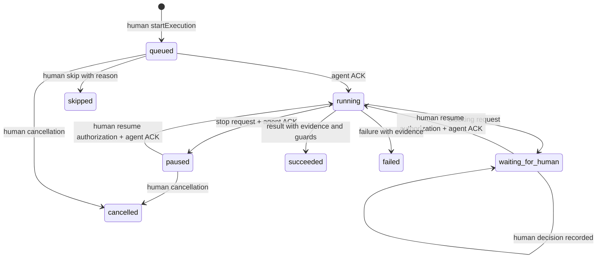
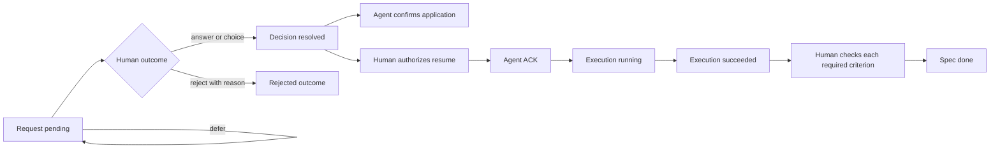

# Исполняемые статусные модели прототипа

Текущий срез — alpha.13. Четыре исходные оси доступны интерактивно с alpha.3: **Спецификации → Состояния**, граф/список, текущее подтверждённое состояние, правила и реальные переходы. Во вкладке **Процесс** отдельный opt-in режим добавляет состояния конкретных посещений шагов. [Схема и состояния](flow-guide.md) · [Учёт проходов](flow-runtime-guide.md) · [Пакеты и проверки](roadmap.md).

Источник поведения: [engine.ts](../packages/core/src/engine.ts), [типы](../packages/core/src/types.ts), [тесты](../tests/core.test.ts). Полная целевая модель: [status-methodology.md](status-methodology.md). Принцип независимых автоматов и guards сверялся с [W3C SCXML](https://www.w3.org/TR/scxml/); SCXML-файл/движок не реализован.

| Ось | Состояния | Авторитетный переход |
|---|---|---|
| Roadmap | draft, active, frozen, archived | Человек; freeze запрашивает остановку, не подделывает ACK |
| Spec | idea, specified, in_progress, blocked, done, invalidated | Projection текущей ревизии; `done` только после human acceptance |
| Execution | queued, running, waiting_for_human, paused, succeeded, failed, cancelled, skipped | Разрешение человека и отдельные факты/ACK исполнителя |
| DecisionRequest | pending, resolved, superseded, withdrawn | Human outcome; author withdrawal; activation новой ревизии явно supersede старые pending |
| FlowRuntime | active, completed, failed, cancelled | Проекция строгого процессного маршрута одной execution; не human acceptance |
| FlowStepRun | ready, running, waiting, succeeded, failed, skipped, cancelled | Одно зарегистрированное посещение узла; явные факты и отдельные human retry/skip |
| Application | Не применено / подтверждено | Отдельное событие DecisionApplied |
| Acceptance | Не принято / принято с evidence каждого обязательного критерия | Отдельное SpecAccepted от человека |

## Проходы шагов · alpha.13

Строгий режим включается только человеком при новом startExecution. Первый ready-run создаётся с разрешением попытки; его нельзя начать до ACK запуска execution. Старые попытки остаются без FlowRuntime и не получают предполагаемые статусы из накопленных Action.

| Состояние прохода | Смысл и источник |
|---|---|
| ready | Проход создан как entry, действительный преемник или человеческий повтор; фактическое начало ещё не подтверждено |
| running | Явно начат текущий шаг; это не итог исполнения |
| waiting | Начат wait либо зарегистрировано связанное ожидание/подтверждённая пауза; время само не завершает шаг |
| succeeded | Явный complete с evidence и выполненными guards; реальный переход создаёт отдельный traversal |
| failed | Явный факт fail начатого прохода с evidence; повтор создаёт новый runId и не переписывает этот результат |
| skipped | Человек с причиной/evidence пропустил допустимый текущий ready action/wait; это не невыбранная альтернатива |
| cancelled | Авторизация открытого прохода закрыта исходом execution; физическая остановка внешней работы этим не доказывается |

У непосещённого узла состояния прохода нет: показывается «Нет зарегистрированных проходов». Карточка узла относится к последнему run, а инспектор позволяет читать точный исторический runId. Несколько входов — обычное слияние выбранного пути; ожидания всех ветвей нет. В маршруте один текущий проход, повторное посещение увеличивает visit данного узла.

Start/complete/retry/skip требуют execution.running и общих guards. Fail текущего начатого running/waiting-прохода допускается и при паузе/stop request/смене ревизии, если execution ещё не завершена: это запись неуспеха, которая не возобновляет работу и не открывает следующий шаг. Failed-run остаётся для явного человеческого retry, который сам требует всех разрешений.

Для основной незавершённой execution активной ревизии FlowRuntime.failed даёт Spec.blocked до допустимого человеческого retry. У прочих ревизий/попыток история сохраняется в своём контексте. Внеплановый Question/Fork/Blocker привязывается к текущему начатому run через flowStepRunId и серверный flowInterrupt, не изображая новый узел схемы. До продолжения нужны текущие решения/применение или clearance и отдельный resume ACK. Отозванный interrupt-Question/Fork допускает обычный шаг после отдельного разрешения человека и ACK; плановый узел всё ещё требует положительного запроса, отзыв Blocker не снимает препятствие. Interrupt-Fork не выбирает ребро плана.

`FlowRuntime.completed` означает достижение явно завершённого result. Execution.succeeded и Spec.done по-прежнему требуют своих отдельных фактов и человеческой приёмки. Детальные команды, владельцы шагов и отличие решения/apply/ACK/traversal: [flow-runtime-guide.md](flow-runtime-guide.md).

## Исходная ось execution

Схема сокращает двухшаговые переходы в подписи. `resumeAuthorized` и `stopRequested` — отдельные признаки, отображаемые UI до ACK. Command receipt означает сохранение факта, а не успех выполнения. Поздний Action старой ревизии остаётся фактом старого контекста и не возобновляет работу.

Fork Ouro — исключающий человеческий выбор, не параллельный gateway BPMN. Blocker approval разрешает план, но сохраняет препятствие: отдельная remediation должна успешно завершиться и предъявить evidence. Другие блокировки при remediation остаются в силе. Ответ/отклонение, запуск и DoD не сливаются в один статус.

Новая активная ревизия не переписывает события: stopRequested для старой попытки, DecisionSuperseded для старых pending; после ACK человек отменяет старую попытку и разрешает новую. Связи зависимостей учитывают человеческую приёмку актуальной ревизии; координаты узлов ничего не разрешают.

Пакет [OURO-ENG-000007](specs/methodology-recovery.md) добавляет уточнения и новые связанные запросы исправления без изменения прежнего outcome. Физический Blocker сохраняется при отзыве/замещении запроса и новой ревизии, пока не получено evidence устранения либо человек явно не пересмотрел применимость к конкретному новому контракту. При возвращении старого контракта требуется новый план/пересмотр.

После экстренного отзыва агента человек может отменить его разрешение отдельным операторским фактом: `cancelled` с `stopConfirmation=unknown`. Это не `ExecutionPaused` и не агентский ACK. Барьер на новое исполнение и архивацию снимается только отдельным свидетельством внешней остановки с identity/evidence оператора. Исторический cursor воспроизводит те же автоматы по подтверждённому префиксу событий в отдельном read-only представлении.
