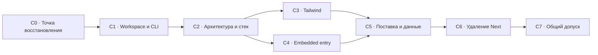

# Завершение миграции Ouro после ретроспективы

Дата: **2026-11-05, Asia/Yekaterinburg**. Статус: **PLAN_PREPARED / IMPLEMENTATION_PAUSED_BY_OWNER**. Основание — поручение пересобрать этапы, зависимости, критерии готовности и объём проверок, сохранив архитектуру. Этот документ не разрешает возобновление реализации, установок, сборок, тестов, публикации или слияния feature PR.

Действующая архитектура — [D01–D16](../proposals/react-vite-migration/decisions.md), [целевые границы](../proposals/react-vite-migration/target-architecture.md), [React-стек](../proposals/react-vite-migration/react-stack.md) и [классификация всех 25 исходных правил](../proposals/react-vite-migration/rules-portability.md). Исходные P0–P7 сохраняются в [плане миграции](../proposals/react-vite-migration/migration-plan.md) как архитектурные области. **Операционный порядок завершения задают C0–C7 ниже.** Порядок меняется; требования не сокращаются.

## 1. От какой точки продолжается план

Это снимок остановки, а не новый runtime audit. Evidence взято из завершённых проверок до остановки и read-only чтения Git. Рабочая ветка эпика — `codex/react-vite-epic@6595e2e30e4a3f800e647404c8ac083a1d6892c0`; [PR36](https://github.com/QahNaaRlN/ouro/pull/36) остаётся draft в dev. В dev/main миграция не интегрирована.

| Область | Уже получено | Что не объявляется завершённым |
|---|---|---|
| Web/service | React/Vite/router, отдельный Hono service,47routes/59methods, ресурсы/lifecycle/runner | Полный installed/hosted cutover и удаление Next |
| Клиентская модель | ProjectSession/Query/SSE, frozen intents/receipts, явные runtime dependencies, scoped catalogs, error-policy/boundary | Все semantic ports, все legacy handlers, изоляция pending state между host/source contexts и embedded composition |
| Tailwind | По ledger1919→112 ordinary rules; осталось2 CSS files и6 geometry expressions в3 files | Общий слой112 rules ещё не переписан; geometry policies не приняты автоматически |
| Локализация | [PR76](https://github.com/QahNaaRlN/ouro/pull/76), head `6afa3160c28721bb3a57c194de6c50436f2d1706`, все5 CI jobs PASS до остановки | PR не слит; один RU pilot не завершает локализацию остальных owned UI |
| Generation launcher | [PR74](https://github.com/QahNaaRlN/ouro/pull/74); `f99ca177` имеет Linux6 jobs PASS и Windows13 functional phases PASS | Local Windows HTML672/1161FAIL сохранён; последний head `88cbba1` добавляет CI/docs, его run отменён; CLI/ZIP/cutover не завершены |
| Незавершённые ветки | Shared-style harness, Form SDD, pnpm SDD, literal MethodologyPage move | Незакоммиченный код не принят; остановленный typecheck не PASS; эти изменения не входят в epic автоматически |

Исходная dirty main worktree, реальные profiles/env/DB и Meridian сохранены. При возобновлении каждый незавершённый срез получает явное решение «продолжить / оставить отдельно / заменить»; файлы, evidence и история не удаляются автоматически.

## 2. Что меняется после ретроспективы

1. **Конечный результат важнее количества срезов.** У этапа есть проверяемый выход и список зависимостей. Атомарная feature-ветка содержит один законченный сценарий или границу; отдельная ветка на каждый helper не требуется. Gitflow сохраняется: feature → epic, весь epic → dev после C7; main/release/deploy отдельно.
2. **Не более двух активных implementation stories.** Вторая допустима при разных файлах/контрактах и отсутствии зависимости от незавершённого результата первой. Локальные install/build/SQL/browser/capture запускаются по одному. Read-only review и документация могут выполняться параллельно.
3. **Инструменты и способ установки определяются раньше массового переноса UI.** CLI/protocol producer, pnpm и правила качества не откладываются до последнего удаления Next.
4. **Финальные style baselines собираются после стабилизации структуры и форм.** Старые пригодные снимки используются в своей области; весь интерфейс не снимается заново из-за перемещения файла без изменения DOM/classes.
5. **У вспомогательной работы есть предел.** Один новый verification gap — один воспроизводимый эксперимент, максимум один цикл ремонта harness и до2 часов активной работы. Если этого недостаточно, текущий продуктовый срез остаётся незакрытым: фиксируются конкретный риск, доступные evidence и способ проверки существующими средствами. Универсальная новая система измерения не разрабатывается по умолчанию. Лимит не отменяет критерии продукта и не разрешает превращать FAIL в PASS.
6. **Повторный запуск имеет причину.** Новый source/dependency/runtime input, исправленный дефект, изменённое предусловие либо действительно незакрытый риск. Неизменный зелёный набор не повторяется локально вслед за тем же CI без причины.

После отдельного поручения возобновить реализацию этапы выполняются по этим зависимостям без повторного выбора D01–D16. Изменение архитектурного решения, wire/authority/data semantics или области задачи оформляется отдельно.

## 3. Этапы и зависимости

| Этап | Результат | Зависит от | Критерий выхода |
|---|---|---|---|
| **C0 — точка восстановления** | Один реестр текущих artifacts, открытых результатов и конечных критериев | Явное возобновление реализации | Для каждого открытого среза известны base/head/dirty state, владелец, disposition и применимые проверки; нет фонового запуска или автоматического merge |
| **C1 — workspace и контракты поставки** | Рабочая pnpm development installation, самостоятельный npm consumer/producer contract, исполняемые universal checks | C0 | Один dev lock, совместимые CLI до frontend build, same-commit protocol producer, clean install/build; все 25 правил имеют scope/решение и способ контроля |
| **C2 — законченная клиентская архитектура** | Физическая hFSD, semantic ports, Form/RU/error/time boundaries в реальных сценариях | C1 | Нет frontend→legacy/server/Next dependencies и скрытых HTTP/host fallback; все UI responsibilities имеют owner; формы и смена контекста сохраняют поведение |
| **C3 — завершённый Tailwind** | Удалены112 ordinary rules;6 geometry expressions квалифицированы | C2 | `styles:final` PASS, нет legacy component CSS/static inline presentation; закрыта конечная visual/interaction coverage matrix |
| **C4 — подключаемый React entry** | Один переносимый UI с явными зависимостями standalone/embedded | C2; окончательная visual проверка после C3 | Export без createRoot/browser router; capabilities, navigation/theme/source/access/host isolation проверены; нет ambient authority |
| **C5 — готовая поставка и данные** | Реальный ZIP/CLI/hosted artifact с React/Vite/service | C1 + C2 + C3 + C4 | Fresh install/launch/restart, protocol/MCP/runner, SQL/resources и закрытая копия старых данных проходят; нет source install fallback |
| **C6 — удаление Next** | Целевые scripts/CI/docs используют только новую поставку | C5 | Next dependency/runtime/config/proxy/temporary aliases удалены; исторический API baseline сохранён и связан с актуальными service bindings |
| **C7 — общий допуск** | Один квалифицированный итоговый commit и интеграция epic в dev | C6 | Полный final набор на одном составе, все обязательные jobs и review PASS, критерии C0–C6 закрыты, открытый обязательный FAIL отсутствует |

Критический путь: **C0 → C1 → C2 → C3 → C5 → C6 → C7**. C4 можно реализовывать после C2 параллельно C3 при разных owners; C5 ждёт оба результата. Подготовка упаковки в C1 не заменяет actual artifact qualification в C5. Даты/скорость не обещаются по числу коммитов: после C0 оцениваются конечные stories, после C1 уточняется срок критического пути.

Перед началом каждой story нужны: exact base и принятые parents; один конечный результат/ответственный owner; неизменяемые authority/data/compatibility условия; локальный профиль и новые риски; конкретный критерий merge. Если один результат требует нескольких stories, их зависимости записываются до начала параллельной работы. Закрытие story требует реализации, соответствующего evidence, review и интеграции в epic; сама подготовка спецификации её не закрывает.

### C0. Восстановление управляемого состояния

- Зафиксировать точный epic и состав принимаемых feature parents. Старые PASS привязать к input/source/runtime, отменённый run оставить CANCELLED. CI не перезапускается автоматически только из-за подготовки этого плана.
- PR76 проверить по имеющемуся exact-head evidence; PR74 не повышать до полного Windows PASS по предыдущему Linux run. Решение о merge — действие реализации после её возобновления.
- Разобрать незавершённые Form/pnpm/MethodologyPage/shared-harness изменения без потери исходников и без смешивания непроверенного кода с принятым epic.
- Для конечных сценариев зафиксировать source/target owner, ожидаемый результат, право/контекст, уже существующую проверку и конкретный недостающий риск. Запись «есть тесты» недостаточна.

### C1. Сначала единый рабочий и потребительский контракт

Последовательность внутри этапа: **C1a compatibility inventory → C1b independent CLI/protocol producer → C1c pnpm и universal checks**.

- Сохранить весь существующий публичный CLI: launch/build/start, agent config/check, MCP, protocol, DB/operator/hosted utilities. Зафиксировать argv/cwd/stdout/exit/env expectations до реализации. В частности, manual agent/MCP tools не приобретают новое требование предварительной frontend build; выданные конфигурации MCP остаются привязаны к своему поколению.
- Сохранить credential/privacy contract: caller-relative token file разрешается от исходного cwd, неоднозначные credentials отклоняются, ключи не попадают в argv/config/logs. Невалидный explicit generation selector завершается отказом без fallback на manual supplement и без выбора другого поколения.
- Завершить generation launcher и owner lifecycle, не добавляя GC/reclaim для неизвестных процессов/неполных поколений. Наличие BUILT pointer не объявляет активное поколение.
- Для developer tree — один pnpm lock и реальные workspace units; для внешнего consumer tree — отдельный согласованный npm lock. Protocol producer получает собственный materialized npm contract: удаление developer npm locks не ломает fresh same-commit protocol build/pack.
- Публичные version/exports/engine expectations переносимого protocol сохраняются: Node 24 приложения не становится новым минимальным Node для существующего protocol consumer без отдельного решения.
- Выбрать совместимые exact tool versions по действительным manifest/runtime inputs. Переход package manager не обновляет все ranges. Новый lock сравнивается с прежними resolved/integrity inputs; peer/native changes объясняются. React/i18n Context identity проверяется production renderer probe.
- Подключить strict types, React hooks/dependencies, naming/public API/JSDoc, formatting и import boundaries в реальных scopes. Сгенерированные и исторические исключения конечны; blanket `any`, test overrides, reverse-import allowlists и отключение правил слоя не допускаются.
- Канонические требования хранятся в Ouro, AGENTS/Cursor adapters ссылаются на них; CBS не нужен на диске для выполнения правил. Классификация всех 25 rules сохраняет обоснованные project-only exclusions. Turbo подключается только при определённом task/cache graph; отдельный проект внедрения Turbo не является условием завершения.

**Доказательство выхода:** свежая Windows/Linux development installation без изменения lock; целевые builds/types/guards; независимые protocol/consumer installs без root node_modules; таблица CLI совместимости и исполняемых rules. Полный ZIP rehearsal остаётся C5. Установка неиспользуемого Form/i18n/Temporal пакета сама по себе не закрывает соответствующее решение.

### C2. Архитектура вместе с реальными сценариями

- Завершить shared UI и api infrastructure, entities с public API, features пользовательских действий, widgets и pages composition. Home не переносится целиком в один widget. Прежний path wrapper допустим только как конечный переходный adapter с владельцем и удалением до выхода этапа; новый frontend не импортирует старые app/components/lib presentation modules.
- Покрыть semantic reads/commands/subscriptions/collaboration и оставшиеся auth/membership/agents/GitHub/Meridian-import/files/verification operations. Привилегированные действия выполняются сервером; общий HTTP/fs/shell proxy для host не появляется. Backend не получает искусственную frontend hFSD.
- Один ProjectSession/snapshot adopter/SSE owner. Query keys, subscriptions, drafts и pending intents имеют явные source/actor/project/access/host scopes. Смена host/project/access изолирует представление и поздние callbacks; исходный frozen command/UNKNOWN сохраняет прежние bytes/author/context и не переотправляется автоматически.
- Завершить TanStack Form/Zod на настоящих формах. Сначала один законченный assign-work pilot, затем остальные формы по тому же contract. Raw input и parsed output различаются; validators не создают intents/requests; confirmed success и false/error/UNKNOWN имеют разные правила очистки. Auto-title, выбранный agent, редактирование во время busy и возврат к черновику сохраняются. Backend validation остаётся обязательной.
- Typed RU resources принадлежат slices; все переносимые owned UI используют согласованный namespace/fallback. Тексты сохранённой истории, пользовательские документы и внешние данные не превращаются в translation keys. Новые языки не добавляются.
- D07 реализует различимые loading/disabled/paused/background/stale/empty/forbidden/error состояния. Null в обязательном поле не маскируется как empty;0/false сохраняются.
- Завершить error ownership/capture на runtime, Query, boundary и async action boundaries с безопасными полями reporter; исключить повторное уведомление одного occurrence. Reporter failure не ломает команду; нового внешнего telemetry сервиса нет.
- D09: типизированный Temporal adapter для новой calendar logic и Intl с явными настройками; записать native/polyfill support для Node, браузера и минимального целевого WebView2. Проверить выбранный путь на этих runtimes либо оставить конкретный support gate открытым. Даты в истории, precision/timezone/wire strings не переписываются; новая календарная продуктовая функция ради библиотеки не создаётся.

**Доказательство выхода:** responsibility/import graph без незакрытых frontend legacy edges; meaningful schema/error/scope/UNKNOWN tests; production Form/i18n renderer и основные Human View/workspace flows. Existing accepted invariants переиспользуются. Перемещение кода без изменения поведения подтверждается literal/AST equivalence и existing consumer checks; искусственный RED ради move не добавляется.

### C3. Общие стили без нового проекта измерений

- Переписать shared/native defaults через явные Tailwind4 recipes у действительных consumers. Сохранить appearance ownership, specificity/cascade, responsive/portal/fullscreen/focus/reduced-motion поведение. Все собственные ordinary styles, включая `/`, входят в результат.
- Удалить legacy ordinary layers, component CSS и статические inline expressions. Theme/base/fonts/keyframes/vendor CSS остаются только в своей технической области;6 geometry expressions получают exact-expression/dependency policies после review. Они не объявляются разрешёнными по одному наличию custom property.
- До кода составить конечную coverage table: каждый из112selectors/recipes → все affected consumers → состояния/breakpoint intervals → assertion/снимок. Число PNG не является критерием завершения. Детальная политика — раздел5.

**Доказательство выхода:** `styles:final` и архитектурные проверки PASS; каждая строка coverage table закрыта actual evidence; visual deltas объяснены, поведение не ослаблено. Полный capture-v2 для всех сочетаний не является новым обязательством.

### C4. Standalone и embedded из одних модулей

- Standalone composition владеет browser root/router и web adapters. Embedded export принимает services, source/actor/project/access/host context, navigation, appearance, locale и capabilities явно, без собственного createRoot/router и без чтения ambient web authority.
- Один и тот же feature/UI code исполняется в обоих composition roots. Missing capability/host показывается явно; отсутствие provider не включает HTTP fallback.
- Embedded использует согласованные React/providers хоста и общий runtime/Query/session owner своего scope. Две панели одного scope разделяют одну историю и SSE lease с корректным refcount/disposal; разные contexts изолированы. Проверяется production identity React/context implementations, а не только отдельный mount каждого экземпляра.
- Проверить две изолированные embedded instances, смену scope/revoke, unmount/cancel/late response и UNKNOWN; отсутствие cross-cache/draft/subscription leakage. Production build не включает Node/server/Next в клиентский entry.

**Доказательство выхода:** реальный production renderer с contract doubles для host и standalone flows. Это основа интеграции, не actual Meridian IPC/SSO/native acceptance; работа в репозитории Meridian не требуется. Отдельный WebView2 support check для выбранных API остаётся явным и не подменяется Chromium-результатом.

### C5. Проверка настоящей поставки и существующих данных

- Собрать checksummed source/ZIP/package artifact из одного committed tree; проверить allowlist/private-data audit и same-commit protocol. Проверять распакованный artifact в foreign/Unicode cwd без Git/source node_modules, а не только producer directory.
- Fresh npm launch/build/start, documented CLI, выданный MCP/remote stdio, runner CJS/ESM/TS, static JS/CSS/font/HTML bytes, direct routes/cookies/SSE, два поколения, restart/exact receipt и штатное закрытие owned children. Повторяемые кейсы используют существующие qualifiers.
- Проверить production hosted image с текущим service/UI, внешним PostgreSQL, cookies/proxy/raw webhook/body limits/background jobs/graceful shutdown. Реальные почтовые отправки/production deployment не входят в этот прогон.
- На изолированной закрытой копии старого fixture profile: backup/restore, старый→новый→допустимый обратный переход, сравнение fingerprints/events/cursors/revisions/registrations/receipts. Не открывать live user DB двумя версиями и не останавливать пользовательский процесс ради теста. Отсутствие schema changes доказывается, а не предполагается.
- Local Windows strict HTML FAIL остаётся открытым фактом до диагностики; чистый Windows CI даёт отдельное platform evidence. Ни фильтр HTML, ни изменение expected/headers ради обхода не закрывают FAIL. Если причина внешняя, точно отделить artifact correctness, машинное ограничение и работоспособный delivery contract; обязательный local contract с незакрытым FAIL не получает PASS.

**Доказательство выхода:** Linux/Windows artifact/platform results и data rehearsal на целевом составе с перечисленными ограничениями. Проверка actual host environment, если она обязательна для заявленного способа поставки, не заменяется CI. Production publication и owner acceptance имеют отдельные статусы.

### C6. Удаление временного Next пути

- Удалить Next entry/config/dependency, runtime adapters, aliases, proxy и generated artifacts. Согласовать dev/build/start, CI, Docker/release/docs с React/Vite/service.
- Исторический47/59HTTP baseline сохранить как источник expected поведения; проверяющий код адаптировать к actual service registry. Не оставлять старые route files только ради зелёного checker и не уменьшать baseline ради удаления.
- На изолированной копии проверить передачу storage ownership: все 47 routes обслуживает service; подтверждённый drain handlers/tasks/workers/SQL → DB.close → освобождение mutex → новый owner. Incomplete drain не закрывает gate и не разрешает открыть второй owner. Это проверка fixture, не переключение production или рабочего профиля.
- Удалить generated Next AGENTS block вместе с самим Next после проверки владельца генерации. Ссылки на историческую миграцию и старые evidence в документации не считаются runtime dependency.

**Доказательство выхода:** dependency/import/bundle audit без Next и временных aliases; clean целевые builds; focused route/navigation/launch checks. Изменение package/CI/runtime inputs запускает применимые consumer checks заново.

### C7. Один итоговый состав

Полный gate на одном exact source/artifact составе: frozen developer install; conventions/types/lint/architecture/naming/style; core/unit/service/SQL/PostgreSQL; protocol standalone ESM/CJS/types/CLI; production web+service builds; весь актуальный functional/browser/presentation набор. После удаления Next из финального commit заново формируется настоящий ZIP и выполняются consumer source/generation/CLI/platform/data gates; C5 остаётся доказательством candidate, а не подменяет этот post-removal artifact. Проверки разных heads не складываются в «общий PASS».

После PASS и review — epic в dev с сохранением атомарных feature histories. Draft PR36 переводится в ready только при закрытых обязательных критериях. Main/release/deploy, actual Meridian native/SSO и человеческая приёмка продукта не присваиваются автоматически техническим результатом C7.

## 4. Разумный объём проверок

| Изменение | Достаточный локальный профиль | Перед feature merge | Итоговый C7 |
|---|---|---|---|
| Документация | Diff, локальные ссылки, ID/статусы/полнота критериев, независимое чтение | Действующие repository rules; этот план локально не публикует PR и не запускает CI | Не требует нового runtime rerun сама по себе |
| Literal move/public API | Equivalence, affected types/import guard и существующие consumer cases | Review и все действующие mandatory jobs exact head | Входит в общий набор |
| Схема/Form/Query/error/scope | Реальный RED для нового поведения, focused unit/contract,1–2 production renderer flows на изменённый риск | Все mandatory jobs; route/SQL/package проверки при затронутых inputs | Полная функциональная регрессия |
| Общий Tailwind | Coverage closure по разделу5, styles/types/architecture и existing interactions | Mandatory jobs и объяснённые visual deltas | Полный существующий presentation/functional набор |
| Lock/runtime/CLI/package/SQL | Fresh relevant installation, qualifier affected boundary, Windows/Linux для платформенного поведения | Consumer/protocol/PostgreSQL/platform jobs по действующим требованиям | Полный actual artifact/data gate |

Этот пересмотр **не отключает и не ослабляет существующие mandatory CI jobs**, skips, assertions, UI/action/navigation/server deadlines, validation limits или authority checks. Оптимизация начинается с устранения локальных дублей, ограничения WIP и законченных feature stories. Перестройка CI не становится самостоятельным предварительным проектом; если действительно нужна, это отдельная bounded change с доказанным сохранением обязательного покрытия.

**Переиспользование evidence.** Для каждого результата хранить source/head, relevant files/dependency/runtime/artifact hashes, fixture identity, команду/профиль, outcome и scope. Docs-only change и literal move могут сохранять прежнее behavioral evidence после подтверждения неизменности inputs; новый финальный commit всё равно проходит свой обязательный CI. Новый graph/runtime/DOM/behavior input инвалидирует соответствующие результаты. Cancelled/setup failure/partial/skip не повышаются до PASS. Нужный общий gate не собирается из разных несовместимых артефактов.

**Повтор после FAIL.** Сначала классифицировать assertion/product, harness или setup failure. Исправлять минимальное доказанное условие и повторять affected profile. Два воспроизведения одной проблемы без новой гипотезы/входного изменения — повод остановить конкретный цикл и пересобрать проверку, а не запускать весь набор снова. Исходный FAIL сохраняется.

## 5. Конечный style coverage contract

Полнота определяется покрытием правил и поведения, а не декартовым произведением всех экранов/тем/ширин. До C3 каждая строка112-rule inventory имеет consumer/state/viewport owner; новый consumer после C2 добавляется в ту же таблицу. Все найденные affected consumers покрываются; текущий ориентир около46 UI files проверяется заново после moves.

- **Полный static audit:** все 112 rules/declarations и6 geometry expressions; inherited/native/typography/control/table/status/portal/fullscreen precedence; vendor priority; все actual media thresholds/conditions, включая17 named breakpoints и отдельный min-width 1600. Проверяется итоговый каскад: перекрытое правило не переносится как новый видимый эффект. Неограниченный allowlist вместо этого аудита запрещён.
- **Visual pairs:** по одному представителю каждого действительно отличающегося render recipe, surface и inheritance/portal context; light/dark и desktop/mobile для theme/responsive recipes. Один representative может закрывать несколько строк только при одинаковом recipe/context и явной ссылке каждого consumer на проверенный случай.
- **Границы:** для 17 named max-width variants — дешёвые affected layout assertions на `b`/`b+1` (34 пробы); для отдельного min-width 1600 — 1599/1600 и effective-style/no-op witness. Дополнительный `b−1` либо `b+1` добавляется при смешанных/пересекающихся условиях, если базовой пары недостаточно. Screenshot нужен там, где меняется layout/typography/видимость и имеющегося assertion недостаточно. Все исходные условия проверяются, каждый breakpoint не умножает все экраны.
- **Состояния:** focus-visible/keyboard, hover, disabled/busy/error/empty, portal/dialog/select, textarea geometry, graph handles/fullscreen и reduced motion проверяются у затронутых recipes. Затронутые existing assertions сохраняются; не относящиеся к изменению состояния не размножаются ради счётчика.
- **Метрики:** размеры/позиции, необходимые цвета/типографика/overflow и состояние DOM/доступности проверяются там, где они реализуют criterion. Полная raw CSSOM snapshot допустима для диагностики конкретного каскада, но не требуется для каждого DOM node/кадра.
- **Один settled PNG на сторону пары.** Сохраняются реальные доменные barriers, fonts и стабильные fixture facts. Не требовать равенства двух последовательных PNG или pre/post CSSOM сериализации как отдельного продуктового свойства. Изменение class strings ожидаемо при переносе; actual geometry/state/appearance обязательны. Не скрывать pixel/metric delta допусками, введёнными после обнаружения различия.
- **Baseline:** после C2 зафиксировать immutable scenario facts; reuse только после read-only identity/state admission. Новые UUID, timestamps, отозванные agents или изменённое состояние не считаются той же парой. Partial/stale fixture явно FAIL, без автоматического повторного seed POST.
- **Fixtures:** existing functional tests сохраняют свои seed/assertions/cleanup. Для paired visual можно выбрать уже стабильный workspace fixture, отдельно покрыв recipe/consumer из исходного теста. Превращение всех функциональных fixtures в новую immutable cache system не является обязательной работой. Изменение состава visual evidence оформляется в coverage table до прогона; старые unmerged harness specs приводятся к этому ограниченному контракту после возобновления.

**Бюджет подготовки:** до начала изменений выбрать из existing specs ориентировочно 40–60 уникальных before/after visual pairs на весь общий слой, распределённых по фактической coverage table. Это planning budget, не порог acceptance. Если оставшиеся rules/contexts не покрываются, сначала объяснить конкретный gap и скорректировать матрицу; нельзя выбросить consumer или обязательную проверку ради лимита. Дополнительные breakpoint/state assertions могут выполняться в уже имеющихся browser cases без отдельного PNG.

Начальная кандидатная матрица содержит 40 пар (80 PNG до/после); после C2 подтверждаются реальные recipes/consumers и проверяется покрытие каждой строки исходного inventory:

| Поверхность/состояния | Пар |
|---|---:|
| Human View roadmap/table и history heading |4|
| Human View request и execution form |4|
| Workspace catalog/overview/help |3|
| Dialog/popup и body portal: обе темы × desktop/mobile |8|
| Verification advanced form и paired card |4|
| Roadmap/process table/state graph |3|
| Issued agent configuration/account form |2|
| Proposal preview/collaboration с UNKNOWN |2|
| Impact/Lessons editor |4|
| Meridian file input/GitHub controls |2|
| Historical sources/recovery |2|
| Onboarding |2|
| **Всего** |**40**|

Light/dark и desktop 1440/mobile 390 распределяются между обычными строками; полное произведение контекстов оставлено рискованным dialog/portal surfaces. Новые fallback/Methodology scenes добавляются только для ещё не покрытого контекста, предварительно ориентир до 4 дополнительных пар. Каждому consumer нужен rendered witness из этой матрицы или существующего functional/render probe; обёртке без оформления — доказательство неизменного DOM/provider/inheritance. Строка «покрыто workspace» без конкретного witness не закрывает coverage.

Шесть geometry expressions имеют отдельные наблюдаемые критерии: Impact — прежний clamp и ширина fill при 0/nonzero; onboarding — highlight/card/panes относительно measured rect, viewport clamp, resize/scroll/focus/scroll restoration; textarea — multiline, смена ширины, скрытое mounted поле и повторное открытие с прежними auto/height assignments. Для каждого сохраняются точный AST owner/dependencies и допустимые custom properties.

Плановое окно: setup smoke до 3 минут и visual+boundary batch ориентировочно до 15 минут на сторону пары. Это бюджет организации работы, а не увеличение или замена existing UI/test deadlines. Превышение требует сохранённого результата и одного ограниченного diagnostic по конкретной причине; оно не запускает новые циклы primer/CDP или автоматического увеличения caps. Pixel delta рассматривается с метриками/state: raster-only отличие сохраняется и получает объяснение/review, не исчезает за подбором удачного повторного снимка.

Прежний workload из 804 кадров не является обязательным новым gate: v1 снимки с 35 properties сохраняют свой ограниченный scope, v2 G1 имеет 24 before frames PASS и 0 after. Их нельзя переименовать в full migration PASS. Не выбрасывать пригодное evidence и не собирать 14 семейств вслепую до проверки необходимости каждого кадра. Existing functional/presentation CI suites сохраняются и выполняются в своих scopes.

## 6. Полнота принятых требований

| Требование | Где закрывается | Обязательное evidence |
|---|---|---|
| D01 mutation ownership, D02 widget composition | C2 | Import/public API graph и сценарный owner без orchestration leak |
| D03 Query/session | C2 + C4 | Один owner, scopes/cancellation/late-response/cache isolation |
| D04 UI errors, D05 retries/UNKNOWN, D06 reporter | C2 + C4 + C5 | Safe normalization/capture, один UI path, exact retry/receipt, reporter failure isolation |
| D07 data states | C2 | Различимые states,0/false/null/schema tests |
| D08 i18n, D09 Temporal/Intl, D10 Form/Zod | C2 | Реальное использование, typed keys/input-output, production identity, runtime support и raw draft preservation |
| D11 naming/docs/strict, D12 canonical rules, все 25 source decisions | C1 и применение в C2–C7 | Исполняемые scopes/checks, finite exceptions, canonical docs/adapters и traceability |
| D13 pnpm/consumer/tooling | C1 + C5 | Один dev graph, independent npm/protocol/CLI, actual package qualification |
| D14 Meridian boundaries | C2 + C4 | Explicit ports/capabilities/context, no ambient host authority; native acceptance отдельно |
| D15 parity | Все этапы + C7 | Реестр сценариев и итоговый exact-composition regression |
| D16 Router/Hono | C2 + C5 + C6 | Сохранённые routes/history/HTTP/stream/lifecycle contracts и отсутствие Next runtime |
| Дополнительное Tailwind4 требование | C3 + C7 |0 ordinary debt, exact technical policies, visual/interaction closure |
| Сохранение данных/CLI/режимов и работа Gitflow | C1 + C5 + C7 | Rehearsal/compatibility evidence и feature→epic→dev histories |

## 7. Как сообщается прогресс

Для stage/story фиксировать отдельно **PLANNED → IMPLEMENTED → VERIFIED → INTEGRATED**. Этап закрывается только при выполнении всех собственных exit criteria; новый план не обнуляет уже проверенную реализацию и не объявляет её финально принятой. После каждого законченного среза отчёт содержит результат, точный состав/evidence, открытые ограничения и следующий dependency; количество коммитов/PNG/tests не используется как процент миграции.

Ретроспективные «около 60%» остаются экспертной оценкой, не формальной baseline метрикой. До оценки оставшихся stories C0 нельзя превращать её в обещание срока. На текущем поручении создан только этот план: **все действия C0–C7 остаются остановленными до отдельного возобновления реализации**.
