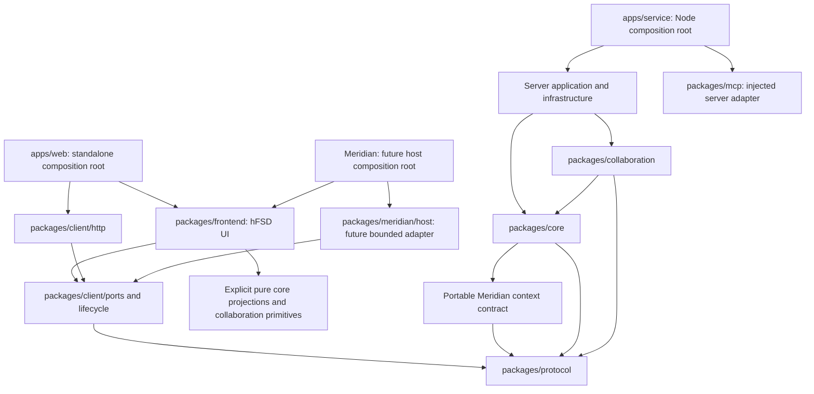

# Целевая архитектура Ouro: React, Vite и отдельный backend

Дата принятия: **2026-11-04**. Статус архитектуры: **Принята владельцем 2026-11-04** на основании всех16рекомендаций D01–D16. Каноническая запись решения и границ — [decisions.md](decisions.md). Реализация **IN_PROGRESS**: React/Vite shell, все backend bindings, единый session/SSE, scoped Query, первые physical boundaries и independent source-build квалифицированы по отдельным историям. Полный cutover/паритет итогового состава ещё **NOT_RUN**; [интеграционный журнал](../../plans/react-vite-integration.md) отделяет фактические PASS от открытых работ. Работа в репозитории Meridian не назначена; полный нативный мост остаётся **NOT_IMPLEMENTED / NOT_VERIFIED / NOT_ACCEPTED**.

## Цель и граница изменения

Ouro должен сохранить действующие пользовательские и агентные сценарии после удаления зависимости от Next.js: самостоятельный веб-интерфейс на React + TypeScript + Vite, отдельный сервис на Node.js + TypeScript и переносимый интерфейс для последующего встраивания в Meridian.

Перенос меняет способ сборки, композиции и запуска. Он не должен молча менять доменную модель, историю событий, протокол агентов, роли, семантику команд, CRDT-черновиков, проверки или приёмки. Интерфейс, доступ к данным и окружение исполнения получают явные границы. hFSD применяется к фронтенду; backend не обязан повторять его слои.

Основания и соседние документы:

- [Общий вход в пакет миграции](README.md).
- [Переносимость исходных Cursor rules](rules-portability.md).
- [Принятый React-стек и его правила](react-stack.md).
- [План миграции с сохранением функциональности](migration-plan.md).
- [Принятые решения D01–D16 и оставшиеся проверки](decisions.md).
- [Существующий RFC ограниченного моста Meridian](../meridian-native-bridge.md).

## Проверенное исходное состояние

Основание таблицы — чтение локальных исходников Ouro 2026-11-04. Это описание кода, а не доказательство, что каждый сценарий успешно исполнялся в этой работе.

| Область | Сейчас | Что сохраняется при выделении |
|---|---|---|
| Клиент | React-компоненты в [components](../../../components), маршруты и layout в [app](../../../app), импорты `next/link` и `next/navigation` | Поведение экранов, графов, редакторов, проектов, участников, истории, проверок и интеграций |
| HTTP | 47 файлов `app/api/**/route.ts`; значительная часть делегирует обработчикам, принимающим стандартные `Request`/`Response` | Адреса, методы, статусы, тела, cookie, ограничения и авторизация до явно согласованного изменения контракта |
| Домен | [packages/core/src](../../../packages/core/src): команды, replay, события, guards, Flow, проверки и производные представления | Одно каноническое применение команды и воспроизведение истории; клиентские проекции не создают серверных фактов |
| Контракты | [packages/protocol](../../../packages/protocol): типы, Zod/JSON Schema, manifest, совместимость, сборка ESM/CJS | Идентификаторы и версии опубликованных контрактов, доступность CLI/пакета для существующих потребителей |
| Хранилище | [lib/store.ts](../../../lib/store.ts): PGlite либо внешний PostgreSQL, транзакции, receipts, сериализация, observer, миграции | SQL как источник истины, проектные блокировки, неизменяемая история и идемпотентность |
| Идентичность | [lib/auth.ts](../../../lib/auth.ts), [lib/user-auth.ts](../../../lib/user-auth.ts), [lib/user-auth-http.ts](../../../lib/user-auth-http.ts), [lib/projects.ts](../../../lib/projects.ts) | Различие human/agent, пользователей/участников, локального и hosted-режимов; актуальные membership и отзыв доступа |
| Обновления проекта | [lib/project-stream.ts](../../../lib/project-stream.ts), [HTTP subscription API](../../../packages/client/src/http/project-subscription/index.ts), [pure snapshot API](../../../packages/client/src/lifecycle/project-snapshot/index.ts) | SSE snapshot/cursor, повторная авторизация, проверка истории, защита от устаревших снимков и разрывов; два прежних lib helpers физически перенесены без изменения API |
| Совместные черновики | [packages/collaboration/src](../../../packages/collaboration/src), [lib/collaborative-drafts.ts](../../../lib/collaborative-drafts.ts), [components/collaborative-drafts.tsx](../../../components/collaborative-drafts.tsx) | Yjs, `updateId`/`clientId`, hash/version head, очередь updates, явная публикация и сохранение неизвестного исхода |
| Агентный доступ | [packages/mcp/src](../../../packages/mcp/src), существующий stdio launcher и HTTP endpoints | MCP tools/resources, agent credentials, project scope, ограничения роли и protocol compatibility |
| Привилегированные операции | [lib/workspace-files.ts](../../../lib/workspace-files.ts), [lib/verification/local-runner.ts](../../../lib/verification/local-runner.ts), [lib/github](../../../lib/github), [lib/mailer.ts](../../../lib/mailer.ts) | Серверный доступ к файлам/процессам/секретам, привязка workspace, provenance проверок, GitHub leases и доставка почты |
| Meridian | [packages/meridian/src/context.ts](../../../packages/meridian/src/context.ts), [lib/meridian/http.ts](../../../lib/meridian/http.ts) | Строгий импорт pinned work-scope v1 и создание черновика; отсутствие неявного права активации/запуска |

Совместное редактирование сейчас использует HTTP-чтение/updates и периодическую синхронизацию. Его нельзя описывать как уже реализованный WebSocket или как часть SSE-потока проекта. Замена этого транспорта не требуется для удаления Next.

## Единицы поставки и владение

Приняты две исполняемые единицы: `apps/web` и `apps/service`. Общие пакеты служат границами зависимостей и повторного использования. Физический перенос каталогов выполняется постепенно; публикация каждого каталога как npm-пакета не требуется.

База инструментов разработки — **pnpm workspaces**. Её внедрение и lockfile оформляются отдельным этапом, без смешивания с изменением домена или transport semantics. **Turborepo** подключается после явного описания графа задач и политики inputs/outputs/env/кэширования; он не обязателен для каждого шага миграции. Действующий npm-контракт внешнего ZIP/launcher, включая `npm run launch`, и переносимого protocol consumer сохраняется через явный этап упаковки и проверки совместимости. Выбор pnpm для разработки сам по себе не меняет способ запуска установленного Ouro.

```text
apps/
  web/
    index.html
    vite.config.ts
    src/
      app/                 # самостоятельный shell, router, providers, bootstrap
      entries/             # standalone entry и отдельный embedded export
  service/
    src/
      bootstrap/           # конфигурация, ресурсы, lifecycle, DI
      http/                # маршруты/Request-Response adapter, static web assets
      application/         # проектные use cases и серверная оркестрация
      infrastructure/      # SQL, identity, mail, files, GitHub, runner
    resources/             # поставляемые SQL migrations и прочие явные ресурсы
packages/
  frontend/
    src/
      shared/              # UI-примитивы, formatting, error presentation
      api/                 # инфраструктура доступа через внедрённые client ports
      entities/            # модели представления, schemas, query keys/hooks, UI
      features/            # пользовательские сценарии
      widgets/             # экранные блоки и их композиция
      pages/               # route-level composition
      embedded/            # UI-контракт встраивания без createRoot и web bootstrap
  client/
    src/
      ports/               # semantic read/command/subscription/collaboration ports
      http/                # ограниченный browser-safe HTTP/SSE adapter
      lifecycle/           # scope, snapshot adoption, pending intents, disposal
  core/                    # существующий домен и чистые проекции
  protocol/                # существующий переносимый versioned contract
  collaboration/           # существующие чистые CRDT/head primitives
  mcp/                     # существующий server-side MCP adapter и stdio entry
  meridian/
    src/
      context/             # переносимый parser/DTO, без native runtime
      host/                # будущий ограниченный adapter согласованных host ports
```

`entries`, `context` и остальные новые пути — принятая целевая структура, а не существующие exports. Расположение конкретных `pages` и app-specific features уточняется по фактическому повторному использованию в рамках принятых границ: специфичный для web или Meridian сценарий может остаться в своей оболочке. Общее поведение не дублируется между двумя app roots.

### Направление зависимостей

Стрелка в схеме обозначает импорт или внедрение зависимости, а не сетевой вызов.



Границы, которые должны получить машинную проверку:

1. `protocol`, чистое `core` и переносимые CRDT/context primitives не импортируют React, Next, Tauri runtime, DOM, HTTP server, SQL drivers, секреты или bootstrap приложения. Схемы и DTO не зависят от UI.
2. Browser bundle не включает `apps/service`, `pg`, PGlite storage owner, `node:fs`, `child_process`, mailer, server-side MCP, credentials или server env. То, что PGlite имеет другие варианты использования, не меняет выбранное владение существующей БД Ouro сервисом.
3. `packages/client/ports` не зависит от React, конкретного HTTP framework или Tauri. HTTP и native adapters реализуют контракт, UI получает экземпляры через composition root.
4. hFSD действует внутри frontend: `app → pages → widgets → features → entities → api → shared`; пропуск нижнего слоя разрешён, обратная runtime-зависимость запрещена. Чистые domain projections и внешние контракты — явно объявленные зависимости соответствующих слоёв, а не повод помещать домен в `shared`.
5. Внешний импорт слайса проходит через его явный public API. Runtime-импорты соседних слайсов по умолчанию запрещены; между entity slices допустим только оговорённый type-only импорт публичного типа. Для widget composition действует узкое исключение D02, описанное ниже, без разрешения всего слоя. Сценарии нескольких сущностей принадлежат features/widgets по ответственности. Внутренние relative imports не должны обходить границы пакетов.
6. Клиент может использовать чистый replay для проверки полученной истории, расчёта preview и отображения. Результат вычисления в браузере не заменяет SQL commit, серверную авторизацию или receipt.

Сейчас `core/engine.ts` импортирует Meridian parser/mapping, а `meridian/context.ts` импортирует `RevisionContent` и Unicode helper из core. Перед закреплением новых package boundaries следует устранить обратную зависимость: переносимые context types/validation primitives не зависят от core; отображение контекста в `RevisionContent` принадлежит доменному import use case. Перенос с сохранением v1 contract проверяется отдельно. Этот документ не утверждает, что такая перестройка уже выполнена.

## Фронтенд: hFSD и состояние

| Слой | Владелец ответственности | Граница |
|---|---|---|
| `shared` | UI-примитивы и context-free utilities | Не знает Project, Spec, actor, router, native host или endpoint конфигурацию |
| `api` | Внедрённые ports, общая обработка transport errors, связь с query runtime | Не читает env и не реализует самостоятельные пользовательские сценарии |
| `entities` | Project/Spec/Execution и другие модели представления, схемы, query key factories, data hooks, компоненты отображения | Не импортирует runtime другой entity; простая mutation допустима только для одной сущности, своих keys и без navigation/custom toast/orchestration |
| `features` | Пользовательское действие, command intent, связанная mutation, локальный workflow, последствия успеха/ошибки | Не объединяется с другой feature через скрытый импорт; общая оркестрация имеет одного явного владельца |
| `widgets` | Самостоятельный экранный блок, composition, локальный UI state | Не содержит своего транспорта или серверного domain use case; данные через публичные hooks/ports нижних слоёв |
| `pages` | Нормализованные route params, выбор экранных блоков, route guards | Не владеет бизнес-командами; route data/prefetch возможны только при явном основании композиции |
| `app` | Router, shell, providers, theme, конфигурация, lifecycle | Не создаёт вторую доменную state machine |

Entity mutation — узкий допустимый частный случай, а не требование поместить простое на вид действие в entities. В Ouro пользовательская команда часто меняет общую историю Project, cursor и подтверждённый snapshot; она не соответствует критерию «только собственная область кэша одной сущности». Такой command intent, его version/receipt recovery и UI-последствия принадлежат feature. Общая transport-функция при этом остаётся на своей нижележащей границе и не обязана дублироваться между сценариями.

По D02 самостоятельные widgets независимы, по умолчанию их компонует page. Универсальная сетка с children — context-free layout primitive и не импортирует конкретные widgets. Структурный widget-контейнер может использовать другой widget через публичный UI-контракт только при реальной необходимости повторного использования: без циклов, скрытого управления чужими запросами/состоянием и самостоятельного доменного сценария. Такое конкретное исключение проходит review с обоснованием и точечной проверкой графа. Предварительный allowlist без действительного случая не создаётся.

Общий server state находится в TanStack Query. UI state — локальный React state либо явно выбранный UI-store при доказанной потребности. Выбор такого store не следует автоматически из Pinia исходного шаблона. Ответы API не копируются в глобальный UI-store или localStorage.

В пределах одного runtime и context scope у проекта один владелец project session, принятого snapshot и SSE lifecycle. HTTP read, command result и SSE проходят через общий snapshot adopter с проверкой `projectId`, cursor/version и целостности истории. Query cache хранит принятый server snapshot, а служебный adopter держит только необходимые данные проверки/монотонности; второй независимо изменяемой копии доменного состояния нет. Панели получают свои projections через selectors/hooks одного подтверждённого состояния, а не открывают независимые SSE-контроллеры и несовместимые entity-кэши. `invalidateQueries` не должен понижать cursor или заменять известную историю устаревшим ответом. Ближайший владелец запроса по D03 определяется ответственностью; это правило не требует разрезать общий Project aggregate. Независимые пользователи и вкладки сохраняют собственные авторизованные сессии.

Mutable `Y.Doc` и очередь неподтверждённых updates принадлежат collaboration session, а не сериализуемому query cache. Query cache может хранить подтверждённый draft head. Локальный ещё не опубликованный текст не является серверным ответом и требует собственного явного lifecycle. Для pending command intent также нужен отдельный журнал восстановления: сохранённый request не означает выполненную команду.

Состояние данных различает валидное значение, допустимую пустоту и недоступность источника/контракта. `null`/`undefined` означает пустоту только там, где согласованная схема разрешает такое отсутствие. Отсутствующее обязательное поле — ошибка контракта; значение до завершения первого чтения — состояние загрузки. `0`, `false` и допустимый пустой список не теряют свой смысл из-за проверки truthiness. Неудачный refetch не превращает подтверждённое значение в пустоту.

## Две оболочки и один контракт встраивания

### Самостоятельный web

Vite собирает статические assets. Web entry создаёт React root, web router и согласованный набор providers, разбирает публичную конфигурацию, создаёт HTTP adapter и передаёт его frontend. Для самостоятельного web принят **TanStack Router**; его совместимая версия и конфигурация проверяются при реализации. Этот web router не является обязательным runtime embedded UI в Meridian. Vite — инструмент сборки и разработки; production не требует Vite dev server.

В production браузер получает UI и `/api/**` с одного origin: сервис может отдавать собранные assets сам либо работать за reverse proxy, сохраняющим этот origin. Отдельный процесс backend не означает обязательный cross-origin браузерный API. SPA fallback применяется к маршрутам UI, но не перехватывает неизвестные `/api/**`, MCP, health или static-resource ошибки.

В development Vite proxy передаёт API, cookie и SSE в локальный сервис. Публичный origin, Host/Origin validation, streaming и Secure/SameSite поведение проверяются в этой топологии явно. Универсальное включение CORS или доверие произвольным forwarded headers не является частью миграции.

### Встраиваемый UI

Embedded export предоставляет React-компонент/дерево экранов и типизированные runtime dependencies. Он не вызывает `createRoot`, не запускает web router, не читает web env/cookie и не устанавливает глобальные event handlers при импорте модуля.

Meridian как host владеет React runtime, корнем, навигацией верхнего уровня, темой и жизненным циклом подключённого интерфейса. Общие React/ReactDOM подключаются как совместимые peer dependencies; отдельная встроенная копия React не поставляется. Один и тот же provider не монтируется повторно скрытым embedded bootstrap. Если для Ouro нужен отдельный scoped QueryClient или error boundary, его создаёт host composition root по явному контракту, с определённым временем жизни и очисткой.

Web-specific layout и embedded layout используют общий контент. Тема приходит как типизированная конфигурация/согласованные tokens. Shell не выдаёт полномочия: отображаемые capabilities и проектный контекст определяют доступность действий, а сервер повторно проверяет право на операцию.

### Bootstrap и dependency injection

Сервис разбирает server env один раз, валидирует режим, DB config, публичный origin, mail/GitHub configuration и пути ресурсов. Web bootstrap получает только публичные параметры. `VITE_*` не содержит credentials и не становится общей конфигурацией packages.

Зависимости runtime создаются явно: semantic client ports, QueryClient, scoped context, logger/error presenter, navigation, theme и clock/ID factories там, где они действительно нужны. В common packages нет чтения `process.env`, `import.meta.env`, глобального selected-project singleton или неявного запуска worker при import. Browser APIs скрыты за своим adapter, когда это необходимо для embedded режима и тестирования.

По D04/D06 нормализация ошибки — чистая функция без toast, записи логов и сетевых побочных эффектов. Основной UI-путь и диагностическая регистрация имеют разных владельцев. Reporter получает разрешённый очищенный context; его собственный отказ не ломает приложение, не меняет исход бизнес-команды и не запускает рекурсивный reporting. Конкретные локальные sinks, ограничения очереди и проверка доставки реализуются явно; принятие интерфейса не означает готового production monitoring.

Для локализации принято направление **i18next + react-i18next** с типизированными ключами и явным namespace ownership. Совместимые версии и настройки загрузки проверяются при реализации; текущие русские тексты и fallback Ouro сохраняются. Новые языки и внешняя система переводов не включаются автоматически.

Для новых вычислений времени приняты **Temporal** и явное различение instant, календарной даты и zoned time; форматирование — через Intl. Native/polyfill adapter выбирается по проверке Node, браузера и Windows WebView2. Существующие timestamps, их точность, зоны и wire-представления сохраняются; смена инструмента не переписывает историю событий.

## Сервис на Node.js и TypeScript

Backend на **Node.js + TypeScript** принят. По D16 **Hono — принятый основной кандидат HTTP adapter**, а не уже квалифицированный production runtime. Его допуск требует фактической проверки streaming `Request`/`Response`, disconnect/AbortSignal, raw webhook bytes, нескольких `Set-Cookie`, body limits, обработки ошибок, background jobs и graceful shutdown. **Fastify** остаётся условной альтернативой при документированном препятствии для Hono; это не два равноправных ещё не выбранных направления. Hono-specific types не проходят за границу server transport adapter. Переписывание бизнес-обработчиков ради нового router не требуется.

Composition root сервиса связывает:

- HTTP routes с auth/project resolution и application use cases;
- единственного storage owner с project-scoped views, SQL migrations и транзакциями;
- identity/membership/participant/agent services с актуальными правами;
- MCP HTTP adapter и существующую модель stdio bridge с теми же серверными use cases;
- GitHub durable jobs/leases, mailer, observers и verification runner;
- статические web assets, health/readiness и конфигурацию запуска.

Текущие handler factories уже принимают зависимости частично. При переносе их composition становится явной: маршрут не создаёт отдельное хранилище на каждый запрос. `globalThis.__ouroStore` и lifecycle Next не служат целевым механизмом владения сервисом.

`next/server.after` в webhook/retry заменяется планировщиком сервиса, связанным с уже сохранённой записью задания. Подтверждение webhook не должно зависеть от случайного существования request scope после ответа; восстановление jobs и leases после перезапуска сохраняется. Таймер сам по себе не является durable queue.

Файлы workspace, binding recovery и Playwright child process остаются server-only. Сервис проверяет выбранную папку/identity, права, limits, timeout, cancellation и provenance результата. Hosted-режим не получает файловую систему компьютера пользователя через перенос UI. Доступ к ней требует отдельно спроектированного и разрешённого local bridge.

## Semantic ports и контракт транспорта

Названия ниже описывают ответственности, а не объявляют готовые API exports.

| Port | Смысл | Существенные ограничения |
|---|---|---|
| Project read | Каталог/метаданные, snapshot, history, разрешённые детали | Явный project/actor scope; runtime validation ответа; отсутствие credentials в DTO |
| Command | Отправка замороженного intent и восстановление его результата | Стабильные `requestId`, actor/project, тело и `expectedVersion`; серверные receipts и актуальная авторизация |
| Project subscription | Подписка на подтверждённые snapshots и состояние соединения | Cursor/version, bounded buffering, unsubscribe, reconnect и history validation |
| Collaboration | Чтение draft head, отправка CRDT updates, публикация | `draftId`, `clientId`, `updateId`, hashes/versions, exact retry и сохранность локальной очереди |
| Session/capabilities | Представление идентичности и доступных функций | Не переносит приватные ключи; недоступность операции объявляется явно |
| Host context | Выбранный Meridian project/subject/run, pins, theme, epoch | Отдельно от Ouro authentication; immutable context, закрытые versions/DTO |

HTTP adapter кодирует эти операции в существующие endpoint families. Он принимает проверенную конфигурацию, допускает только объявленные операции/методы, ограничивает URL construction и project selection, поддерживает abort/timeout и необходимые byte/body caps. Он не принимает URL, headers или executable request template из доменного документа. Поддержка web API не превращается в универсальный native HTTP proxy.

Автоматический retry изменяющих команд по умолчанию равен нулю; UI, Query и Error Boundary не повторяют mutations по политике GET. Предусмотренные контрактом точные повторы, например CRDT update с прежним `updateId`, имеют собственное явное основание идемпотентности. Дедупликация query, идемпотентность command, CRDT update identity и транспортный correlation ID — четыре разных механизма.

### Команды и неизвестный исход

Intent фиксируется до отправки: operation, project, исходная identity, стабильный `requestId`, точное тело, версия/контекст и при необходимости body hash. `expectedVersion` защищает от принятия команды на другом основании; он не изменяется внутри повтора того же intent.

Сервис повторно проверяет действующие права и schema, выбирает project вне произвольного command body, блокирует нужную запись проекта и атомарно сохраняет события с receipt. Совпадение `(project, actor, requestId)` с другим телом возвращает конфликт. Receipt возвращает подтверждённый результат, но не восстанавливает отозванные полномочия.

Потеря ответа, abort клиента, timeout, перезапуск или отсутствие видимого изменения не доказывают отказ команды. Ошибка схемы ответа после возможного commit одновременно является contract error и **UNKNOWN** исхода записи: она не означает, что вход был отвергнут до записи. UI сохраняет **UNKNOWN / «результат не подтверждён»** и исходный intent. Восстановление использует предусмотренный текущей операцией exact retry с прежним actor/request/body либо отдельно описанный receipt protocol. Универсальный read-receipt endpoint этой архитектурой не объявляется существующим.

Смена пользователя не позволяет разрешить исход старой команды через отсутствие receipt у новой identity. Для повторного исполнения того же действия новый requestId не используется, пока прежний исход не разрешён; новое независимое человеческое намерение имеет собственный ID и проходит свои guards. Optimistic UI не помечает доменную команду выполненной до подтверждения. Публикация CRDT и verification runner сохраняют свои отдельные receipts/reservations и состояния неопределённости.

### SSE и совместное редактирование

SSE сохраняет `snapshot` frames, согласованный `id/cursor/state.version`, heartbeat, авторизацию и bounded demand-driven delivery. На backend сохраняются abort/disconnect cleanup; proxy не буферизует поток. На клиенте соединение ещё не означает подтверждённое прикладное состояние: оно появляется после валидного snapshot.

HTTP read, command result и SSE могут завершаться в ином порядке. Общий adopter проверяет project, монотонность и совпадение известного history prefix. Устаревший ответ не откатывает состояние; другой prefix или cursor reset требует явного восстановления, а не слияния догадок. При отказе авторизации подписка закрывается и приватный cache перестаёт отображаться.

CRDT транспорт сохраняет текущую семантику HTTP sync до отдельного решения. Потеря ответа на update повторяется с прежним `updateId`, не создаёт новый update identity. Публикация проверяет draft version/hash и base revision, не считается обычным сохранением текста. Новое SSE/native/WebSocket-воплощение collaboration port должно доказать те же свойства отдельно.

## Auth, полномочия и хранение

Для web базой остаются same-origin HTTP и серверные HttpOnly cookie: сейчас пользовательская сессия использует `SameSite=Strict`, `Path=/`, `Secure` при HTTPS. Host/Origin проверки, body/schema caps и запрет подмены project/actor сохраняются. Перенос не заменяет cookie на токен в localStorage и не меняет CSRF policy неявно.

Service различает локальный demo/operator режим и hosted с реальной identity/PostgreSQL. Local-demo credentials не становятся допустимым hosted fallback. Agent credentials не выдаются browser cookie, роли human/agent и участие в проекте проверяются на каждом соответствующем серверном действии.

Для Meridian credential provisioning/storage — отдельное открытое host-решение. `view_handle`, context token, snapshot pin или активный проект не являются human credential Ouro. WebView получает состояние доступа и разрешённый результат операции; SQL credentials, auth secrets, mail/GitHub tokens и signing material остаются вне renderer. Нет готовности SSO, пока отдельный контракт и проверка не доказаны.

Namespace query/persisted данных включает identity/session scope и project; для host-данных также binding/context epoch. Сохраняются только явно разрешённые UI preferences и минимальные identifiers по соответствующей policy. Для неподтверждённых команд сохраняется действующий контракт recovery metadata без секретов; он не обещает долговременного хранения тела. Непринятый CRDT-текст остаётся в открытой вкладке с возможностью экспорта по текущему контракту. Новый durable draft store требует отдельного решения и не включается молча в миграцию. Cookies и project preference не заменяют pinned scope конкретного запроса.

## Жизненный цикл контекста и процесса

### Смена проекта, участника, host selection или unmount

1. Composition root создаёт новый context generation/epoch и немедленно прекращает новые writes через старый scope.
2. Старые reads отменяются по возможности; SSE, collaboration polling, listeners и timers закрываются. Одна отмена не является доказательством отмены уже принятой сервером команды.
3. Все callbacks, cache writes и reconnect проверяют identity/project/generation. Поздний ответ старого scope не появляется в новом проекте, включая ошибки, toast и loading state.
4. Query cache изолируется/очищается по ownership; старые приватные данные не используются как placeholder другого пользователя. Cursor/adopter и native context token не переиспользуются между scopes.
5. Неподтверждённая команда остаётся привязана к прежней identity/project. Непереданные CRDT updates и локальный текст требуют явного сохранения/экспорта/решения пользователя; автоматическое уничтожение или перенос в новый scope запрещены.
6. Новый UI получает свежий snapshot, capabilities и подписку; writes открываются только при подтверждённом контексте и соответствующем основании доступа. Для host смены проверяются project/provider/workspace/repository/subject/run и pins.

Cleanup идемпотентен. Повторный mount/unmount в development не запускает два worker, два владельца storage или две отправки команды. Mutation side effects выполняются из пользовательского intent, а не из самого факта появления компонента.

### Запуск backend

1. Launcher явно выбирает local/hosted режим, origin, endpoint и storage profile. Миграция не создаёт новый пустой `OURO_DATA_DIR` из-за другого рабочего каталога.
2. Bootstrap валидирует конфигурацию и получает абсолютные пути к данным, migrations, static assets и исполняемым ресурсам. Текущая загрузка migrations от `process.cwd()` не переносится как скрытое предположение.
3. Для PGlite приобретается проверяемое эксклюзивное владение одним каталогом одним процессом; повторный запуск на тот же profile завершается понятной ошибкой. Renderer, stdio bridge и второй service не открывают этот каталог параллельно. Конкретный механизм межпроцессного ownership реализуется и проверяется в рамках этой принятой границы; обычная JS-очередь сама по себе её не обеспечивает.
4. Storage owner выполняет согласованный migration sequence до readiness. Для внешнего PostgreSQL сохраняются migration advisory lock и транзакционная координация между процессами. Инициализация/seed не переписывает существующие события, проектные metadata и receipts.
5. После готовности migrations/storage и необходимых зависимостей регистрируются HTTP/MCP и запускаются workers/observers. Readiness проверяет реальную БД; один занятый TCP-порт не означает готовность.

Внешний PostgreSQL допускает отдельный масштабируемый процессный режим при сохранении SQL locks/leases. Правило single-process ownership относится к embedded PGlite profile, а не служит запретом внешнего PostgreSQL.

### Остановка backend

Service снимает readiness, прекращает приём новых writes/jobs, закрывает SSE и новые подписки, останавливает observer/worker timers и допускает завершение ограниченного набора in-flight транзакций. Runner children завершаются по существующей управляемой cancellation policy; при неизвестном результате нельзя синтезировать success/failure.

После согласованного drain закрываются MCP sessions, DB pool/PGlite и освобождается ownership profile. Аварийное завершение оставляет восстанавливаемые SQL receipts/job leases/runner reservations. Остановка Vite или вкладки не закрывает общий backend чужой сессии. Если в будущем Meridian запускает локальный сервис, его ownership и остановка определяются host lifecycle отдельно от mount/unmount embedded UI.

## Основа Meridian и конкретный остаток

Существующий [RFC](../meridian-native-bridge.md) описывает snapshot Meridian `1d3a9f80b196498b5fe2d8a1357f2aaef2aa9c76` от отдельного исследования. Это не подтверждение текущей версии host и не принятый API. Предложенные там `ouro_context_read` и `ouro_draft_import` обслуживают ограниченное чтение контекста/импорт черновика; через них невозможно объявить готовыми полный Project read, commands, SSE, collaboration, auth и verification Ouro.

Первый результат подготовки — экспорт embedded UI, semantic ports, dependency injection, lifecycle/dispose contract и способность явно показать `unsupported`/недоступный сервис. Реальный native adapter включается только для операций, которые host отдельно объявил, реализовал и разрешил. Оставшиеся операции не перенаправляются молча через generic HTTP/fs/shell.

Для native transport нужны отдельные согласованные версии DTO/envelope, capabilities, request/correlation identity, byte limits, cancellation, queue/backpressure и subscription semantics. Context switch закрывает прежний context token. Credentials и endpoint binding задаёт host/operator, а не документ или WebView. CSP не ослабляется ради iframe или подключения произвольного backend.

Импортированный контекст остаётся данными с provenance. Он не становится исполняемой инструкцией, подтверждённой внешней подписью, правообладателем или фактом активации/приёмки. Действующий `unverified_import` нельзя повысить до trusted только из-за нативного caller.

Готовность web migration, browser embedded harness и реальная Windows/WebView2 интеграция — разные результаты. Успешная сборка или mock host не является native acceptance. Нативный host package, доступные в нём полномочия, credential storage и полное покрытие операций остаются отдельным объёмом работ.

## Что требуется доказать до заявления о сохранении функциональности

- Все текущие HTTP/MCP операции и UI сценарии имеют владельца в целевой структуре; ни один endpoint не заменён SPA fallback, а действия не пропали под видом очистки архитектуры.
- Те же histories/commands дают те же domain events, guards и receipts; существующие сохранённые профили и внешний PostgreSQL открываются без изменения смысла данных.
- Auth/session, membership revoke, exact retry, UNKNOWN recovery, проектный scope и host-independent command identity сохраняются при новой топологии.
- SSE, GET и mutation races не откатывают snapshot; смена project/identity закрывает старые subscriptions и не смешивает cache.
- CRDT updates и публикация сохраняют identity/hash/version/conflict и неподтверждённые локальные данные; offline/reconnect не создаёт повторную публикацию.
- Local runner, workspace binding recovery, GitHub durable jobs и MCP работают в своих прежних границах; startup/shutdown и эксклюзивное владение PGlite проверены отдельно.
- В production web bundle отсутствуют Next и server-only dependencies, а shared contracts/core не получают framework/runtime imports.
- Embedded harness доказывает контракт UI и очистку lifecycle; native host capabilities и Windows/WebView2 отдельно остаются `NOT_IMPLEMENTED / NOT_VERIFIED / NOT_ACCEPTED` до своей фактической реализации и проверки.

Точный маршрут и проверки каждой порции переноса определены в [плане миграции](migration-plan.md). Повторного выбора D01–D16 не требуется: они приняты владельцем и закреплены в [decisions.md](decisions.md). Реализация этой миграции ещё не начата; совместимые версии, конкретные adapters/configuration, Hono transport qualification, task graph/cache policy и механизмы lifecycle остаются предметом выполнения и проверки в рамках принятых решений. Реальные native host operations, credentials и приёмка Meridian имеют отдельный объём и полномочия; принятие интерфейсной основы их не реализует и не разрешает автоматически.
