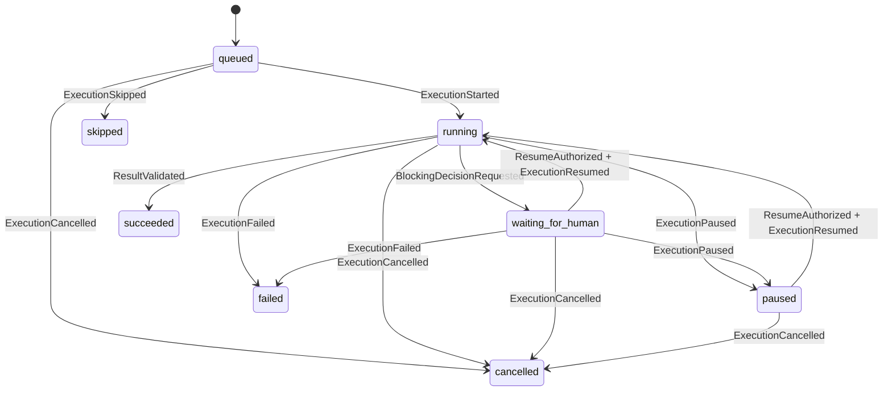

# Ouro: статусные модели и неизменяемая история

Статус документа: модель требований, проверяемый срез реализован в прототипе `0.1.0-alpha.1`. Не все будущие операции доступны в UI. [Точный объём](prototype-scope.md), [реализованные переходы](implemented-states.md). Дата: 2026-10-28. Ревизии сущностей отделены от SemVer продукта.

## Зафиксировано пользователем

- Human View предназначен прежде всего для человека. Агенты сообщают факты и уточняют решения у человека.
- Для Question, Fork и Blocker требуется участие человека. Уверенность модели не может заменить решение человека. :codex-annotation{index="1"}
- Необходимы отдельные модели исполнения и принятия решения, методология неизменяемой истории, согласованные контракты. :codex-annotation{index="2"} :codex-annotation{index="3"} :codex-annotation{index="4"}
- Будущая интеграция с Meridian учитывается через устойчивые идентификаторы и независимые доменные контракты; неизвестные контракты Meridian не объявляются существующими.

Остальная конкретика ниже — проектные предложения, разрешающие пробелы исходных документов.

## 1. Три разных понятия

1. **Reality Event** — неизменяемый факт, например «агент начал действие», «агент обнаружил блокер», «человек ответил». Событие существует однажды и не меняет свой статус.
2. **Execution** — конкретная попытка выполнения задачи в рамках зафиксированной ревизии спеки. Текущее состояние восстанавливается из событий этой попытки.
3. **Decision Request** — отдельный запрос решения, связанный со спекой, её ревизией и при необходимости попыткой выполнения. Решение человека и результат исполнения показываются рядом, но не заменяют друг друга.

У Action нет требования approval: `decisionRequestId = null`. Success/Fail — события результата конкретной попытки. Они не означают, что человек подтвердил выполнение всех DoD спеки.

## 2. Roadmap

Состояния: `draft` (черновик), `active` (активна), `frozen` (заморожена), `archived` (архив).

| Переход | Кто | Условия и эффект |
|---|---|---|
| `draft → active` | Человек с правом управления | Есть название, цель и хотя бы одна спецификация; опубликована текущая ревизия дорожной карты |
| `active → frozen` | Человек | Новые запуски запрещаются; текущим выдаётся запрос остановки в безопасной точке; не объявлять процессы остановленными до подтверждения |
| `frozen → active` | Человек | Возобновляются возможности запуска; остановленные попытки не запускаются автоматически |
| `draft/active/frozen → archived` | Человек | Для работающих попыток предварительно подтверждена остановка/завершение; история остаётся доступной |

`archived` — терминальное состояние этой roadmap. Продолжение оформляется новой roadmap со связью `derived_from`. Заморозка — административная пауза, а не автоматически обнаруженный технический Blocker.

## 3. Spec

Состояния исходного ТЗ сохраняются с нормализованными машинными значениями: `idea`, `specified`, `in_progress`, `blocked`, `done`, `invalidated`. `speced` из первоначального SQL заменяется на `specified` до выпуска первого API.

| Переход | Основание |
|---|---|
| `idea → specified` | Человек активировал полную ревизию: цель, DoD, зависимости, ограничения, допущения и риски заполнены либо явно помечены «не применимо» |
| `specified → in_progress` | Запущена первая разрешённая попытка на активной ревизии; обязательные зависимости удовлетворены |
| `in_progress → blocked` | Появился блокирующий запрос решения, непройденная обязательная зависимость или незакрытый технический Blocker |
| `blocked → in_progress` | Все блокирующие основания сняты; человек явно разрешил продолжение, если остановка требовала человеческого решения |
| `in_progress/blocked → specified` | Человек активировал новую ревизию; новые работы используют её, а остановка старых попыток подтверждается отдельно |
| `done → specified` | Человек активировал новую ревизию той же цели; прежняя приёмка остаётся привязанной к старой ревизии |
| `in_progress → done` | Предъявлены актуальные подтверждения всех обязательных DoD; нет блокирующих незавершённых попыток/запросов; человек подтвердил завершение |
| `idea/specified/in_progress/blocked/done → invalidated` | Человек признал ревизию цели неактуальной, указав причину и при наличии ссылку на замену |

Спека не становится `done` только из-за сообщения агента `success`. Новая ревизия после `done` не переписывает старую приёмку: её нужно активировать отдельным событием, переведя спеку в `specified`; доказательства DoD повторно связываются с новой ревизией. Новая самостоятельная цель получает новую спеку; исправление/уточнение той же цели — новую ревизию существующей.

Открытый неблокирующий Question показывает индикатор «требуется ответ», но не обязан переводить всю спеку в `blocked`. Spec может иметь несколько попыток; агрегирование учитывает только попытки, относящиеся к активной ревизии и обязательным работам. Поле `attentionRequired` выводится из запросов решений, а не вводится как ещё один статус жизненного цикла.

При инвалидации или активации новой ревизии запрещаются новые обычные запуски на прежнем контракте. Работающим попыткам отправляется запрос остановки в безопасной точке; до ACK показывается «остановка запрошена», а не подтверждённая остановка. Их события продолжают сохраняться с прежним `specRevisionId` и пометкой неактуального контекста. Нельзя начинать конфликтующую запись в той же области до подтверждённой остановки или явно разрешённой передачи работы. Попытка не перепривязывается к новой ревизии; новый контракт получает новую попытку. Если Ouro только наблюдает стороннего агента и не может обеспечить остановку, это явно показывается человеку.

## 4. Execution: состояние исполнения

| Значение | Метка Human View | Смысл |
|---|---|---|
| `queued` | В очереди | Попытка создана, ещё не начата |
| `running` | Выполняется | Агент подтвердил начало/возобновление |
| `waiting_for_human` | Ожидает решения | Продолжение данной работы требует человека |
| `paused` | Приостановлено | Человек/политика остановили работу без утверждения технического блокера |
| `succeeded` | Попытка успешна | Работа попытки завершена с проверяемым результатом |
| `failed` | Попытка завершилась ошибкой | Продолжение этой попытки прекращено с причиной и evidence |
| `cancelled` | Отменено | Человек отменил попытку |
| `skipped` | Пропущено | Человек явно отказался от ещё не начатой попытки, сохранив причину |

| Исходное состояние | Допустимые следующие | Основные guards |
|---|---|---|
| `queued` | `running`, `cancelled`, `skipped` | Запуск только на активной ревизии, активной roadmap и с удовлетворёнными обязательными зависимостями |
| `running` | `waiting_for_human`, `paused`, `succeeded`, `failed`, `cancelled` | `succeeded` запрещён, пока есть связанные блокирующие запросы/блокеры; остановка фактической работы подтверждается агентом |
| `waiting_for_human` | `running`, `paused`, `cancelled`, `failed` | Возобновление требует подходящей директивы человека, закрытых блокирующих запросов и подтверждения агента |
| `paused` | `running`, `cancelled` | Явное разрешение человека; актуальная ревизия и доступные зависимости |
| `succeeded/failed/cancelled/skipped` | Нет | Повторная работа создаёт новый `executionId`, связанный `retryOfExecutionId` |

Обнаружение Fork/Blocker останавливает зависимую от решения ветвь. Question содержит `blockingScope`: конкретная попытка/ветвь либо `none`; сервер вычисляет итоговую блокировку и не позволяет агенту ослабить уже действующие ограничения. Агент может продолжать независимую, ранее разрешённую работу. Сам факт отклонения запроса не выдаёт разрешение продолжить спорный путь.

## 5. Decision Request: состояние решения человека

Состояние запроса: `pending | resolved | withdrawn | superseded`.

| Значение | Значение для пользователя |
|---|---|
| `pending` | Требуется решение; комментарий или перенос срока не закрывает запрос |
| `resolved` | Человек вынес решение; отдельно показывается `outcome` |
| `withdrawn` | Автор отозвал актуальность вопроса с причиной; это не человеческое одобрение и не разрешение продолжить |
| `superseded` | Запрос заменён новым с явной ссылкой; блокировка переносится на актуальный запрос |

У `resolved` обязательны `outcome`, проверенная сервером человеческая идентичность, время, основание и применимые параметры:

| Тип запроса | Допустимый `outcome` | Обязательное содержимое |
|---|---|---|
| Question | `answered`, `rejected` | Для `answered`: ответ человека; для `rejected`: причина |
| Fork | `approved`, `rejected` | Для `approved`: ID существующей предложенной опции; для `rejected`: причина |
| Blocker | `approved`, `rejected` | Для `approved`: выбранный план устранения/обхода; для `rejected`: причина |

Все терминальные состояния запроса неизменяемы в его истории. Исправление решения создаёт новый запрос/решение со ссылкой `supersedesDecisionId`; прежнее сохраняется. `DecisionDeferred` оставляет запрос `pending`, меняя только проекцию срока/ответственного. `DecisionClarificationRequested` сохраняет запрос открытым и разрешает только явно обозначенное уточнение.

Одобрение плана снятия Blocker не означает, что препятствие исчезло. Blocker закрывается событием `BlockerCleared` с evidence; если для обхода меняется спека, нужна также активированная человеком ревизия. До выполнения этих условий `waiting_for_human`/`paused` либо продолжающаяся разрешённая работа по устранению не объявляется общим успехом.

Чтобы устранение не зависело от уже устранённого блокера, человек может разрешить отдельную попытку `executionKind=remediation` с `remediatesBlockerId`, выбранным планом и ограниченной областью действий. Эта попытка имеет те же lifecycle-состояния, но её запуск специально разрешён при открытом целевом Blocker. Остальные ограничения сохраняются. Основная работа остаётся заблокированной; после подтверждённого устранения создаётся `BlockerCleared`, и только затем разрешается её продолжение. Успех remediation сам по себе не завершает исходную спеку.

## 6. Применение решения и возобновление

Решение человека содержит отдельный `executionDirective`, например `continue_current_revision`, `activate_revision`, `create_spec`, `cancel_execution` или `none`. Это не отдельный инструмент произвольного запуска кода: сервер проверяет полномочия и ограничения домена.

В API решение фиксирует outcome и допустимую область последующих действий; отправка внешней команды выполняется отдельной командой исполнения. Human View может объединить оба шага одной формой, явно показывая их последствия. Поле `executionDirective` ниже описывает доменное разрешение, а не автоматически исполняемый произвольный payload `resolveDecision`.

- `continue_current_revision` разрешает возвращение на точно указанную ревизию и область работ. Статус `running` возникает после `ExecutionResumed`, а не сразу после нажатия «Одобрить».
- `authorize_remediation` разрешает отдельное ограниченное исполнение по выбранному плану устранения конкретного Blocker; исходная работа остаётся заблокированной.
- `activate_revision` требует готовой immutable ревизии и явного выбора человека. Текущая попытка остаётся привязана к исходной ревизии; новая работа на изменённом контракте получает новую попытку.
- `create_spec` создаёт новую спеку только после явного человеческого решения и с указанием отношения к исходной (`derived_from`, `replaces` либо `depends_on`). Любое одобрение Fork не порождает новую спеку автоматически.
- `none` фиксирует ответ/решение без разрешения продолжать работу.
- Если есть другие блокирующие запросы, один ответ не возобновляет попытку.

Примечание: диаграмма показывает завершённые подтверждённые переходы. Команда Pause/Cancel/Resume и подтверждённое состояние процесса различаются; пока подтверждения нет, Human View показывает «остановка запрошена»/«возобновление запрошено» как операционный индикатор.

## 7. INSERT-only: методология

### Авторитетная история

В таблицах истории запрещены UPDATE/DELETE для прикладных ролей. Каждое создание, изменение содержания, решение, переход состояния и изменение связи — новая запись. Повторный запрос не создаёт повторный факт. Состояния в таблицах чтения являются производными, а не вторым источником правды.

Командный `requestId` служит ключом идемпотентности; сервер переносит его в контекст причинности события. Минимальный envelope события: `eventId`, `workspaceId`, `projectId`, `aggregateType`, `aggregateId`, `aggregateVersion`, `eventType`, `schemaVersion`, `occurredAt`, `recordedAt`, `actor`, `correlationId`, `causationId`, `requestId`, `payload`. `actor` содержит `kind`, `principalId` и необязательный `agentInstanceId`; эти поля устанавливает сервер из аутентифицированного контекста; агент не может выдать себя за человека через payload.

- `aggregateVersion` — монотонный номер событий одного агрегата; это порядок воспроизведения внутри потока.
- `schemaVersion` — версия схемы типа события; её совместимость управляется независимо от номера ревизии спеки и версии приложения.
- `occurredAt` — заявленное время факта, `recordedAt` — время сервера; таймлайн по умолчанию использует серверный порядок, а не ненадёжные часы агентов.
- `causationId` указывает непосредственную причину, `correlationId` связывает цепочку; связи графа хранятся явно и не восстанавливаются догадкой из timestamp.

### Спеки и изменения

`SpecCreated` задаёт неизменяемую идентичность. `SpecRevisionProposed` сохраняет новое содержание целиком либо детерминированный diff с гарантированно доступной базой. Для MVP рекомендуется полный снимок содержания каждой ревизии. `SpecRevisionActivated` — человеческое решение, которое меняет текущую проекцию активной ревизии.

Запуск всегда фиксирует `specRevisionId`. Агент может предложить новую ревизию, но не активирует её самостоятельно. Старые доказательства, решения, execution и зависимости сохраняют ссылки на соответствующие ревизии. Перенос evidence на новую ревизию — отдельное явное действие с проверкой применимости.

Ошибку в событии исправляют `EventCorrectionRecorded`/компенсирующим событием со ссылкой на исходное; история остаётся видна. Ошибочное решение не редактируется задним числом. Нельзя заявлять «защищено от администраторского вмешательства» только из-за application permissions; tamper evidence и внешние аудиторские копии — отдельное расширение.

### Проекции и согласованность

Предлагается Event Sourcing + CQRS: авторитетный журнал append-only; обновляемые проекции `current_specs`, `current_executions`, `current_decisions`, `roadmap_nodes`, `roadmap_edges` можно пересобрать из журнала. На них разрешены UPDATE/DELETE технической роли проектора. Это явное уточнение первоначального «только INSERT»: требование относится к истории и ревизиям, а не к одноразовым кэшам.

Если «INSERT-only» должен распространяться на все таблицы без исключений, проекции сохраняются версиями, а текущее состояние выбирается по последней версии/представлению. Это возможно, но увеличивает объём и стоимость запросов; для MVP предлагается первый вариант. `agents.last_seen` также является пересоздаваемой проекцией heartbeat, а не изменением задним числом истории.

Команда атомарно дописывает события и запись transactional outbox в PostgreSQL. Realtime доставляет уведомление только после commit. Проектор хранит checkpoint; браузер показывает версию и при отставании делает запрос актуального снимка. WS/SSE не являются хранилищем истины.

## 8. Конкурентность, повторная доставка и восстановление

- Клиент передаёт `expectedVersion`; сервер атомарно проверяет версию и дописывает следующий номер. Уникальность `(aggregateId, aggregateVersion)` не позволяет двум конфликтующим командам победить одновременно.
- Для решения обязательны версия запроса и `specRevisionId`: если ревизия или опции изменились, сервер возвращает конфликт и актуальный снимок, не применяя выбор к другой задаче.
- При гонке двух людей первое валидное решение фиксируется, второе получает конфликт. «Последний клик победил» не применяется.
- `requestId` обязателен для мутаций; область уникальности включает tenant/project, principal и операцию. Повтор с тем же payload возвращает исходный результат; с иным payload — конфликт. Один `hash(reason)` недостаточен: одинаковые причины могут относиться к разным фактам.
- Публикация и доставка at-least-once: подписчик дедуплицирует по `eventId`, хранит cursor и запрашивает пропуски после reconnect. Не обещается exactly-once end-to-end.
- Неявный timeout не одобряет решения и не объявляет смерть агента успехом. При потере heartbeat Human View показывает «связь потеряна»; подтверждённые состояния работы сохраняются до нового события.
- Транзакция человеческого решения и его доменных последствий атомарна в границах PostgreSQL. Внешние команды агенту доставляются через outbox; их подтверждение — отдельное событие. Повторная доставка одной команды не порождает новый запуск.

## 9. Human View и минимальная приёмка

Карточка показывает независимо: «Состояние работы», «Решение человека», «Ревизия спеки», «Актуальность связи с агентом». Например: **Ожидает решения · Развилка · pending · rev 3**; после одобрения: **Возобновление запрошено · approved · rev 3**, затем **Выполняется · approved · rev 3**. Цвет дополняется текстом/иконкой; движение отключается при reduced motion. Приоритет визуального оформления — дизайн Meridian после изучения доступного источника. :codex-annotation{index="5"}

Проверки при реализации:

1. Question нельзя автоматически закрыть confidence-порогом; у решения проверяется человеческий principal.
2. Одобренный Fork не становится успешным execution и не создаёт новую спеку без явной директивы.
3. Approve плана Blocker не скрывает препятствие до evidence его устранения.
4. Две одновременные команды решения дают один результат и один конфликт; повторная доставка команды идемпотентна.
5. Полная пересборка проекций из событий даёт те же состояния и связи.
6. Изменение содержания создаёт новую ревизию, старый execution продолжает ссылаться на старую.
7. Потеря WS/heartbeat не закрывает запросы и не меняет работу на succeeded.

## 10. Осознанные ограничения первой версии

Полный BPMN engine, распределённые транзакции и самостоятельный оркестратор кода не требуются для Human View MVP. Ouro фиксирует и доставляет доменные решения; интеграционный адаптер должен подтвердить их применение агентом/Meridian. Это ограничение продукта следует явно показывать: запись события сама по себе не доказывает, что внешний агент действительно остановился.
